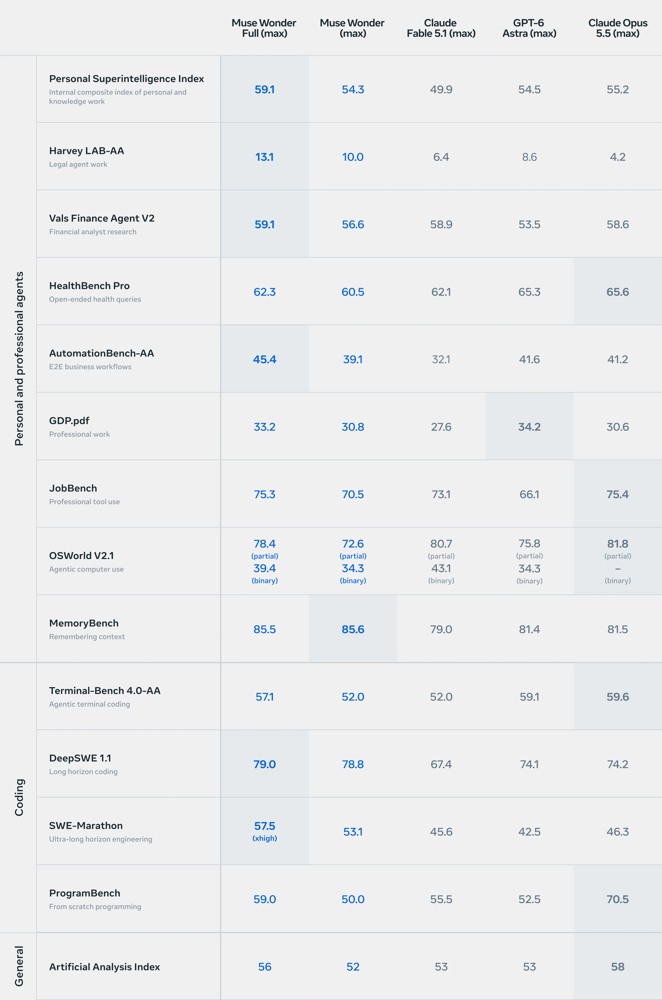
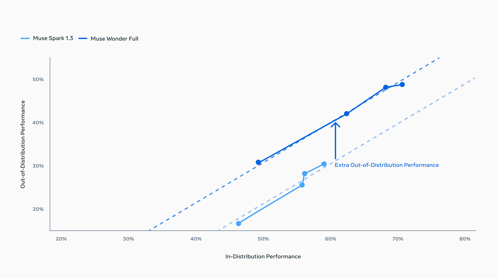

# Muse Wonder / Wonder Full

[Official source](https://research.meta.ai/blog/muse-wonder)

Today, we’re excited to introduce the Muse Wonder series with Muse Wonder and Muse Wonder Full, our most capable models that deliver state-of-the-art performance on personal and professional agentic tasks. Together, they mark the next step on our scaling ladder and a major leap toward personal superintelligence. Muse Wonder brings together Active Memory and Active Focus to keep track of what matters to you and work diligently toward what you want to accomplish.

Muse Wonder is available today through the Meta Model API and Muse Code, and Muse Wonder Full is available today for Muse Code subscribers.

