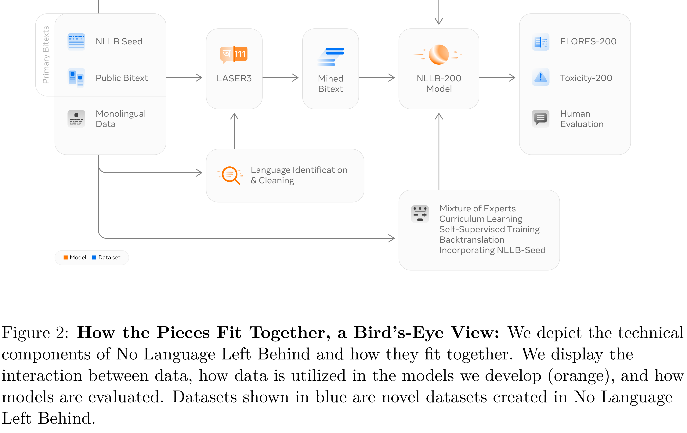

# No Language Left Behind: Scaling Human-Centered Machine Translation

[Official source](https://arxiv.org/abs/2207.04672)

## Abstract

Driven by the goal of eradicating language barriers on a global scale, machine translation has solidified itself as a key focus of artificial intelligence research today. However, such efforts have coalesced around a small subset of languages, leaving behind the vast majority of mostly low-resource languages. What does it take to break the 200 language barrier while ensuring safe, high quality results, all while keeping ethical considerations in mind? In No Language Left Behind, we took on this challenge by first contextualizing the need for low-resource language translation support through exploratory interviews with native speakers. Then, we created datasets and models aimed at narrowing the performance gap between low and high-resource languages. More specifically, we developed a conditional compute model based on Sparsely Gated Mixture of Experts that is trained on data obtained with novel and effective data mining techniques tailored for low-resource languages. We propose multiple architectural and training improvements to counteract overfitting while training on thousands of tasks. Critically, we evaluated the performance of over 40,000 different translation directions using a human-translated benchmark, Flores-200, and combined human evaluation with a novel toxicity benchmark covering all languages in Flores-200 to assess translation safety. Our model achieves an improvement of 44% BLEU relative to the previous state-of-the-art, laying important groundwork towards realizing a universal translation system. Finally, we open source all contributions described in this work, accessible at https://github.com/facebookresearch/fairseq/tree/nllb.

Figure 2: How the Pieces Fit Together, a Bird’s-Eye View: We depict the technical components of No Language Left Behind and how they fit together. We display the interaction between data, how data is utilized in the models we develop (orange), and how models are evaluated. Datasets shown in blue are novel datasets created in No Language Left Behind.

p. 6
