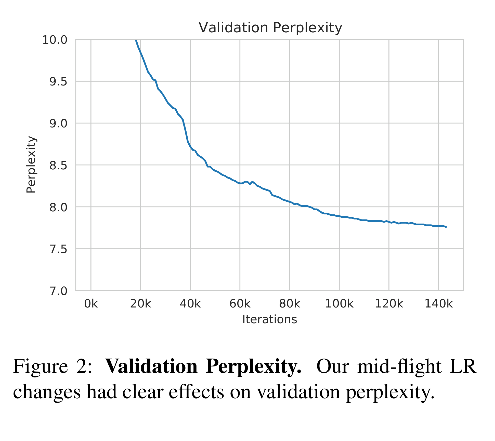

# OPT: Open Pre-trained Transformer Language Models

[Official source](https://arxiv.org/abs/2205.01068)

## Abstract

Large language models, which are often trained for hundreds of thousands of compute days, have shown remarkable capabilities for zero- and few-shot learning. Given their computational cost, these models are difficult to replicate without significant capital. For the few that are available through APIs, no access is granted to the full model weights, making them difficult to study. We present Open Pre-trained Transformers (OPT), a suite of decoder-only pre-trained transformers ranging from 125M to 175B parameters, which we aim to fully and responsibly share with interested researchers. We show that OPT-175B is comparable to GPT-3,1 while requiring only 1/7th the carbon footprint to develop. We are also releasing our logbook detailing the infrastructure challenges we faced, along with code for experimenting with all of the released models.

Figure 2: Validation Perplexity. Our mid-flight LR changes had clear effects on validation perplexity.

p. 3
