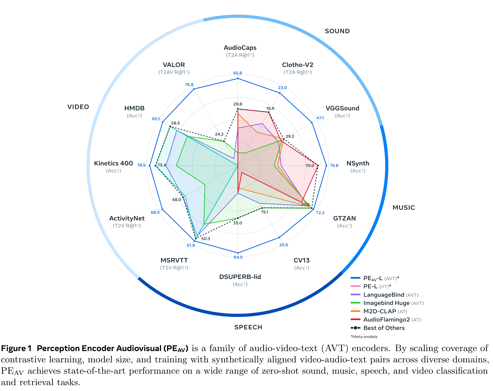
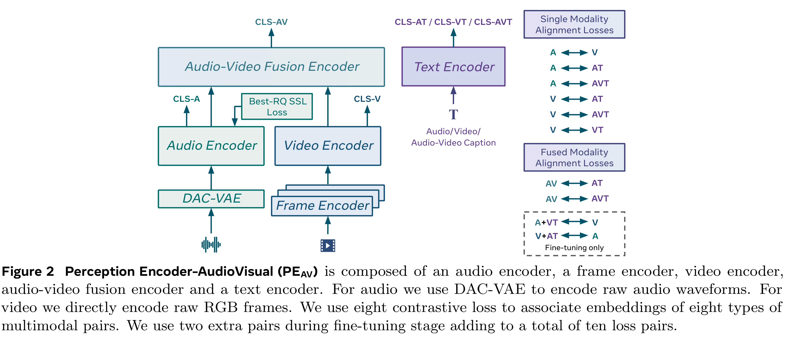

# Pushing the Frontier of Audiovisual Perception with Large-Scale Multimodal Correspondence Learning

[Official source](https://arxiv.org/abs/2512.19687)

We introduce Perception Encoder Audiovisual, PEAV, a new family of encoders for audio and video understanding trained with scaled contrastive learning. Built on PE [8], PEAV makes several key contributions to extend representations to audio, and natively support joint embeddings across audio–video, audio–text, and video–text modalities. PEAV’s unified cross-modal embeddings enable novel tasks such as speech retrieval, and set a new state of the art across standard audio and video benchmarks. We unlock this by building a strong audiovisual data engine that synthesizes high-quality captions for O(100M) audio–video pairs, enabling large-scale supervision consistent across modalities. Our audio data includes speech, music, and general sound effects—avoiding single-domain limitations common in prior work. We exploit ten pairwise contrastive objectives, showing that scaling cross-modality and caption-type pairs strengthens alignment and improves zero-shot performance. We further develop PEA-Frame by fine-tuning PEAV with frame-level contrastive objectives, enabling fine-grained audio-frame-to-text alignment for tasks such as sound event detection.

Figure 1 Perception Encoder Audiovisual (PEAV) is a family of audio-video-text (AVT) encoders. By scaling coverage of contrastive learning, model size, and training with synthetically aligned video-audio-text pairs across diverse domains, PEAV achieves state-of-the-art performance on a wide range of zero-shot sound, music, speech, and video classification and retrieval tasks.

p. 2

Figure 2 Perception Encoder-AudioVisual (PEAV) is composed of an audio encoder, a frame encoder, video encoder, audio-video fusion encoder and a text encoder. For audio we use DAC-VAE to encode raw audio waveforms. For video we directly encode raw RGB frames. We use eight contrastive loss to associate embeddings of eight types of multimodal pairs. We use two extra pairs during fine-tuning stage adding to a total of ten loss pairs.

p. 3
