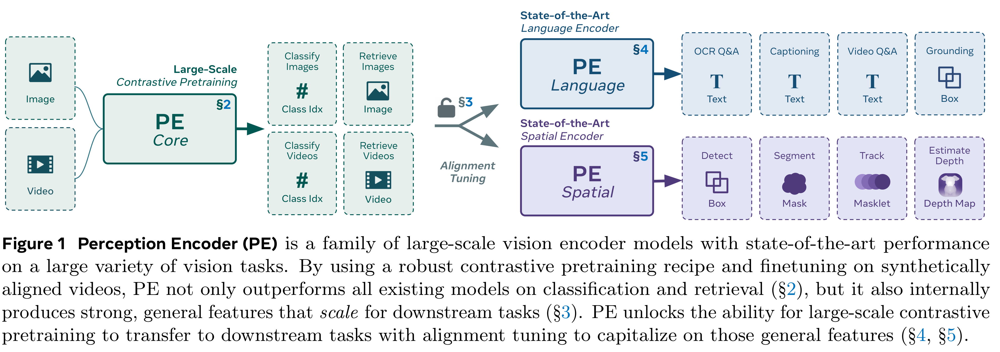
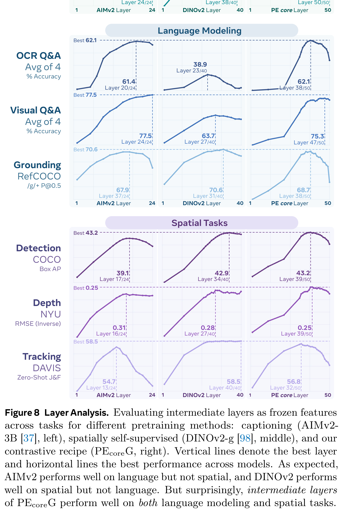

# Perception Encoder: The best visual embeddings are not at the output of the network

[Official source](https://arxiv.org/abs/2504.13181)

We introduce Perception Encoder (PE), a state-of-the-art vision encoder for image and video understanding trained via simple vision-language learning. Traditionally, vision encoders have relied on a variety of pretraining objectives, each tailored to specific downstream tasks such as classification, captioning, or localization. Surprisingly, after scaling our carefully tuned image pretraining recipe and refining with our robust video data engine, we find that contrastive vision-language training alone can produce strong, general embeddings for all of these downstream tasks. There is only one caveat: these embeddings are hidden within the intermediate layers of the network. To draw them out, we introduce two alignment methods: language alignment for multimodal language modeling, and spatial alignment for dense prediction. Together, our PE family of models achieves best-in-class results on a wide variety of tasks, including (1) zero-shot image and video classification and retrieval, simultaneously obtaining 86.6 average zero-shot ImageNet robustness and 76.9 zero-shot Kinetics-400 video classification; (2) document, image, and video Q&A, enabling 94.6 DocVQA, 80.9 InfographicVQA, and 82.7 PerceptionTest with an 8B LLM; and (3) spatial tasks such as detection, tracking, and depth estimation, setting a new COCO state-of-the-art of 66.0 box mAP. To foster further research, we release our models, code, and novel dataset of synthetically and human-annotated videos.

Figure 1 Perception Encoder (PE) is a family of large-scale vision encoder models with state-of-the-art performance on a large variety of vision tasks. By using a robust contrastive pretraining recipe and finetuning on synthetically aligned videos, PE not only outperforms all existing models on classification and retrieval (§2), but it also internally produces strong, general features that scale for downstream tasks (§3). PE unlocks the ability for large-scale contrastive pretraining to transfer to downstream tasks with alignment tuning to capitalize on those general features (§4, §5).

p. 2

Figure 8 Layer Analysis. Evaluating intermediate layers as frozen features across tasks for different pretraining methods: captioning (AIMv2- 3B [37], left), spatially self-supervised (DINOv2-g [98], middle), and our contrastive recipe (PEcoreG, right). Vertical lines denote the best layer and horizontal lines the best performance across models. As expected, AIMv2 performs well on language but not spatial, and DINOv2 performs well on spatial but not language. But surprisingly, intermediate layers of PEcoreG perform well on both language modeling and spatial tasks.

p. 11
