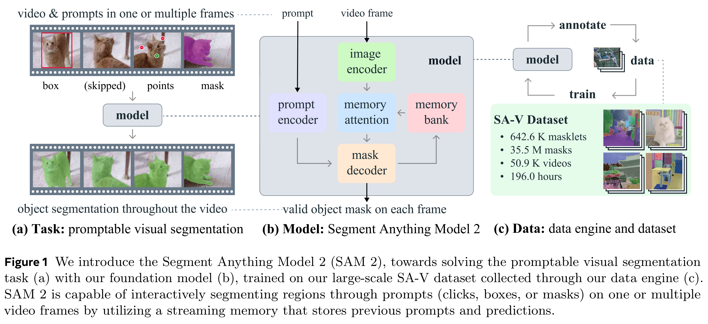
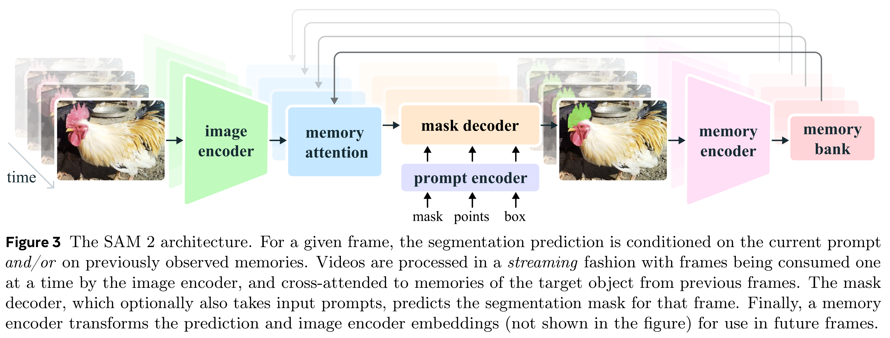
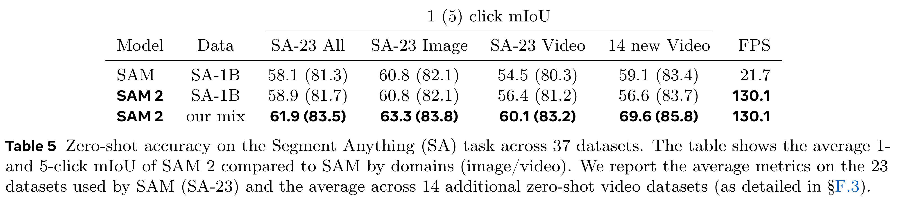

# SAM 2: Segment Anything in Images and Videos

[Official source](https://arxiv.org/abs/2408.00714)

We present Segment Anything Model 2 (SAM 2), a foundation model towards solving promptable visual segmentation in images and videos. We build a data engine, which improves model and data via user interaction, to collect the largest video segmentation dataset to date. Our model is a simple transformer architecture with streaming memory for real-time video processing. SAM 2 trained on our data provides strong performance across a wide range of tasks. In video segmentation, we observe better accuracy, using 3× fewer interactions than prior approaches. In image segmentation, our model is more accurate and 6× faster than the Segment Anything Model (SAM). We believe that our data, model, and insights will serve as a significant milestone for video segmentation and related perception tasks. We are releasing our main model, dataset, as well as code for model training and our demo.

Figure 1 We introduce the Segment Anything Model 2 (SAM 2), towards solving the promptable visual segmentation
task (a) with our foundation model (b), trained on our large-scale SA-V dataset collected through our data engine (c).
SAM 2 is capable of interactively segmenting regions through prompts (clicks, boxes, or masks) on one or multiple
video frames by utilizing a streaming memory that stores previous prompts and predictions.

p. 2

Figure 3 The SAM 2 architecture. For a given frame, the segmentation prediction is conditioned on the current prompt
and/or on previously observed memories. Videos are processed in a streaming fashion with frames being consumed one

p. 5

Table 5 Zero-shot accuracy on the Segment Anything (SA) task across 37 datasets. The table shows the average 1-
and 5-click mIoU of SAM 2 compared to SAM by domains (image/video). We report the average metrics on the 23
datasets used by SAM (SA-23) and the average across 14 additional zero-shot video datasets (as detailed in §F.3).

p. 11
