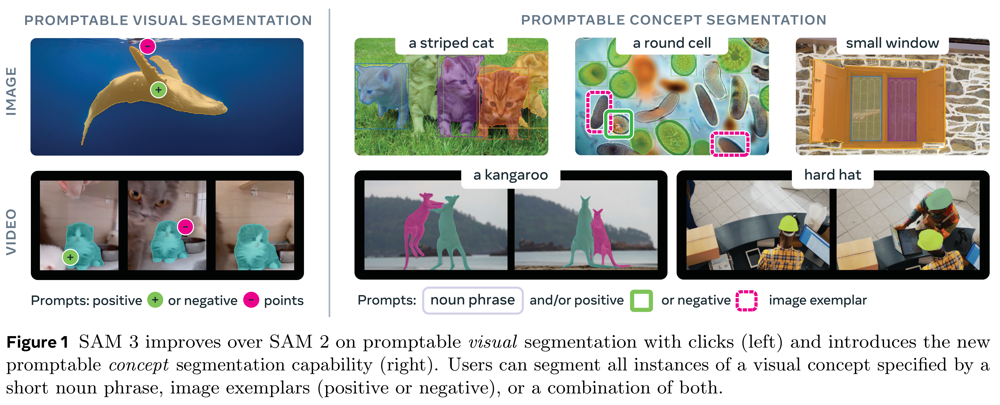
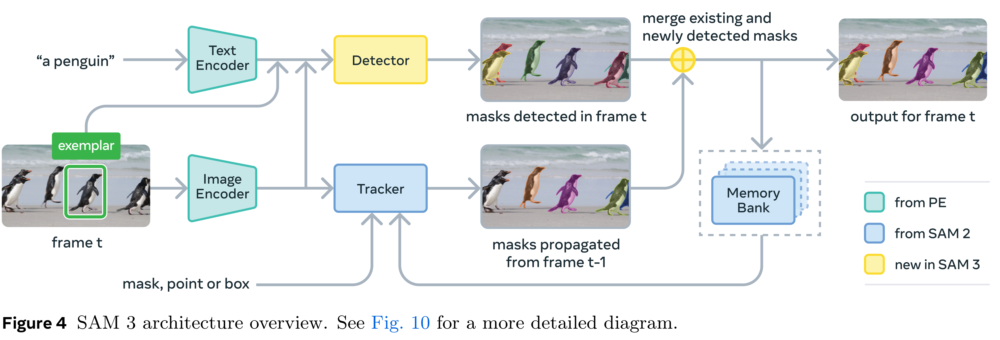
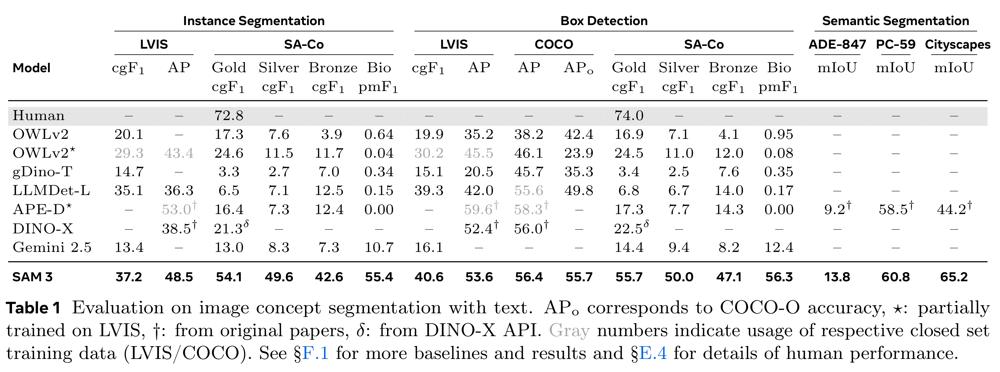

# SAM 3: Segment Anything with Concepts

[Official source](https://arxiv.org/abs/2511.16719)

We present Segment Anything Model (SAM) 3, a unified model that detects, segments, and tracks objects in images and videos based on concept prompts, which we define as either short noun phrases (e.g., “yellow school bus”), image exemplars, or a combination of both. Promptable Concept Segmentation (PCS) takes such prompts and returns segmentation masks and unique identities for all matching object instances. To advance PCS, we build a scalable data engine that produces a high-quality dataset with 4M unique concept labels, including hard negatives, across images and videos. Our model consists of an image-level detector and a memory-based video tracker that share a single backbone. Recognition and localization are decoupled with a presence head, which boosts detection accuracy. SAM 3 doubles the accuracy of existing systems in both image and video PCS, and improves previous SAM capabilities on visual segmentation tasks. We open source SAM 3 along with our new Segment Anything with Concepts (SA-Co) benchmark for promptable concept segmentation.

Figure 1 SAM 3 improves over SAM 2 on promptable visual segmentation with clicks (left) and introduces the new promptable concept segmentation capability (right). Users can segment all instances of a visual concept specified by a short noun phrase, image exemplars (positive or negative), or a combination of both.

p. 1

Figure 4 SAM 3 architecture overview. See Fig. 10 for a more detailed diagram.

p. 4

Table 1 Evaluation on image concept segmentation with text. APo corresponds to COCO-O accuracy, ⋆: partially trained on LVIS, †: from original papers, δ: from DINO-X API. Gray numbers indicate usage of respective closed set training data (LVIS/COCO). See §F.1 for more baselines and results and §E.4 for details of human performance.

p. 8
