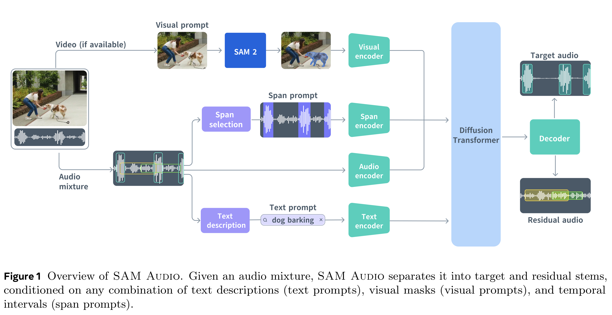
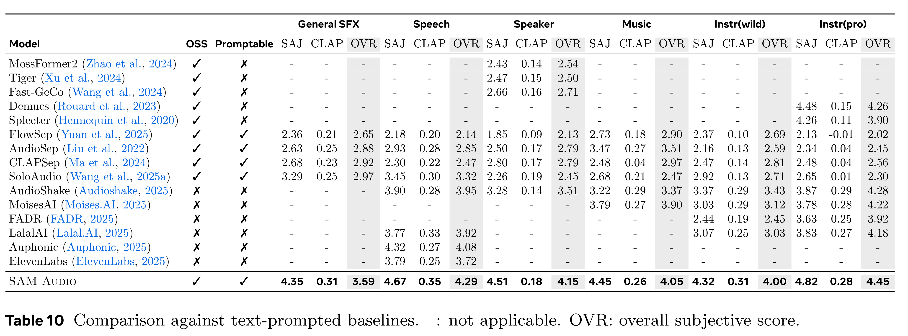

# SAM Audio: Segment Anything in Audio

[Official source](https://arxiv.org/abs/2512.18099)

## 1 Introduction

Audio source separation aims to decompose a complex sound mixture into individual source tracks corresponding to distinct sound events. Separation systems play an essential role in a broad range of real-world applications. In the production and creative domains, they enable sound engineers to isolate and remix individual stems, restore archival recordings, or remove unwanted background noise. In education and accessibility, separation can highlight key sounds or voices for learners or assistive listening devices. From a research perspective, it also serves as a valuable testbed for studying audio understanding in multimodal AI systems, as effective separation requires identifying the individual sources, an essential element of AI models understanding audio.

Audio separation has been studied extensively, and existing approaches can be broadly grouped into promptless and prompted methods. Promptless systems aim to decompose an audio mixture into a fixed set of predefined sources and have shown strong performance in specialized tasks such as speech enhancement, speaker separation, and music demixing (Mitsufuji et al., 2022; Fabbro et al., 2024; Zhao et al., 2024; Kong et al., 2023). However, these methods assume a fixed output configuration and rely on predefined taxonomies of sound categories. As a result, they struggle to adapt to open-domain mixtures or user-defined sound types, where boundaries between sound classes are ambiguous and highly context dependent. Recent progress has shifted the field toward prompted separation, in which the target source is specified through an external signal. Text prompts (Liu et al., 2024b; Yuan et al., 2025; Ma et al., 2024; Wang et al., 2025a; Hai et al., 2024) allow users to describe arbitrary sound events (e.g., “dog barking”, “female speech”) and thereby remove the need for fixed taxonomies. Visual prompts (Zhao et al., 2018; Huang et al., 2024; Li et al., 2024b; Ephrat et al., 2018; Dong et al., 2023) complement text by providing instance-level grounding, enabling disambiguation when multiple similar sources appear in the same scene.

The prompted separation paradigm greatly expands the applicability of separation, but important challenges remain. First, current text-prompted systems are largely benchmarked on general sound effects and often struggle in specialized domains such as music or speech. For example, text-based instrument separation significantly lags behind domain-specific methods like Demucs (Rouard et al., 2023; Défossez, 2021). While these specialized models perform well within their own domain, they cannot generalize beyond fixed source types. Second, visual-prompted systems are comparatively underexplored and typically tested on small or synthetic datasets. Real-world videos contain a mix of on-screen and off-screen sources and ambiguous sound–vision correspondences, making it unclear whether simply selecting a visual region is sufficient for reliable separation. Finally, existing models struggle to distinguish subtle but perceptually important differences between similar sounds such as variants of movie sound effects, which are hard to express precisely with text alone. These challenges point to the need for a more flexible and universally high-performing prompting framework that integrates cues of various modalities to guide separation.

Meanwhile, progress in audio separation research has also been slowed by the lack of unified benchmarks and reliable evaluation metrics. Existing text-prompted models are typically evaluated on disparate test sets, often focusing narrowly on environmental sound separation, with limited coverage of speech and music. In contrast, traditional benchmarks such as MUSDB (Rafii et al., 2017) for instrument separation are restricted to a few predefined stems and are incompatible with prompting. Furthermore, widely used objective metrics such as Signal-to-Distortion Ratio (SDR) rely on synthetic mixtures with clean reference stems, which are scarce or nonexistent in real recordings. Reference-free metrics like CLAP similarity (Wu et al., 2023) offer some insight into audio–text alignment but correlate poorly with human judgment of separation quality (see Section 7.8). These limitations make it difficult to compare models fairly and to assess true performance in open-domain scenarios.

In this work, we introduce Segment Anything Model Audio (SAM Audio), a foundation model for general audio separation that unifies text, visual, and temporal prompting within a single framework. SAM Audio allows users to specify what to separate using a text description, where to separate using a visual mask via positive/negative clicks, and when to separate using a temporal span prompt. These modalities can be used independently or jointly, enabling flexible interaction — for example, a user can describe “piano playing” in a music video and highlight the corresponding region to isolate it precisely. At the core of SAM Audio is a diffusion transformer trained with flow matching on large-scale audio mixtures spanning speech, music, and general sound events. During inference, the model simultaneously produces the target stem along with a residual stem capturing all remaining audio content.

Contributions. Our main contributions are threefold.

• We propose SAM Audio, the first foundation model that supports multimodal prompting (text, visual, span) – used either individually or in combination, for open-domain audio separation, achieving state- of-the-art results for both in-the-wild and professional audios of general and specialized domains (e.g., speech, music).

• We introduce span prompting, a novel form of temporal conditioning that enables precise frame-level control for audio separation.

• We develop a unified and comprehensive separation benchmark, SAM Audio-Bench, that covers major audio domains (speech, music, and sound effects), includes human-labeled multimodal prompts, and provides a reference-free automatic evaluation model with strong correlation to human perception.

Figure 1 Overview of SAM Audio. Given an audio mixture, SAM Audio separates it into target and residual stems, conditioned on any combination of text descriptions (text prompts), visual masks (visual prompts), and temporal intervals (span prompts).

p. 5

Table 10 Comparison against text-prompted baselines. –: not applicable. OVR: overall subjective score.

p. 23
