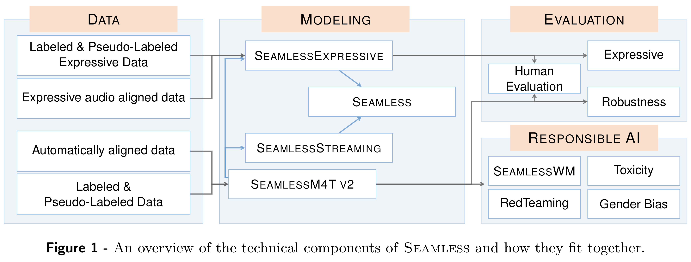
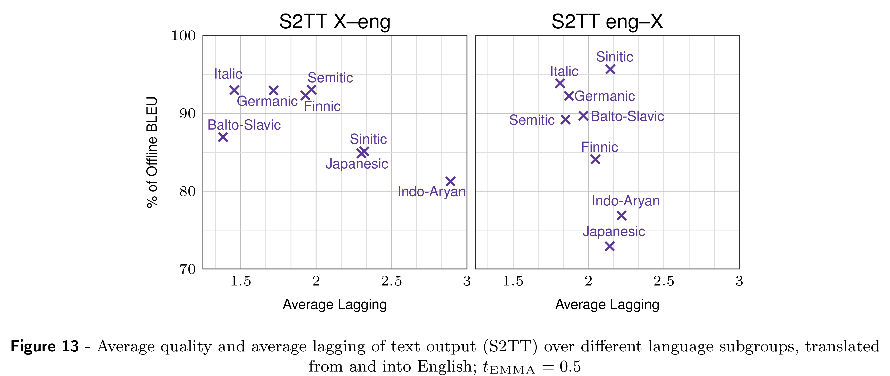
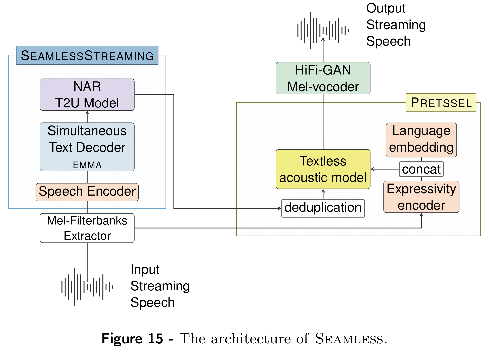

# Seamless: Multilingual Expressive and Streaming Speech Translation

[Official source](https://arxiv.org/abs/2312.05187)

## 1. Introduction

German literary critic Friedrich Schlegel once said, “What is lost in the good or excellent translation is precisely the best.” When applied to speech, this sentiment implies that even when a translation accurately renders the semantic meaning of an utterance, certain defining elements of speech may be lost in the process (Schuller et al., 2013).

While the specific constituents of what Schlegel deemed the best are open for interpretation, the speech translation research community has long homed in on two components: the indexical (i.e., components marking the characteristics of a person) and pragmatical (i.e., the way communication works in social situations) components of speech that make human communication what it is. For speech to be natural, it relies on the indexical or revelatory nature of the human voice (Costello, 2000). A speech translation system that incorporates features that help a listener make inferences about a speaker’s personhood bolsters the naturalness of a machine-mediated interaction (Waytz et al., 2014). Preserving vocal style also involves capturing the prosodic elements of speech (e.g., pitch, stress, rhythm), which are key in facilitating the expression of meaning, emotions, and intent (Aguero et al., 2006; Anumanchipalli et al., 2012). Next, human speech and translation are sensitive to pragmatic nuances such as turn-taking and timing controls (Cokely, 1986; Levinson, 2016). Picture how human simultaneous interpreters work: they find just the right balance between low-latency and accurate translations. Waiting too long stifles the flow of communication, while going too fast compromises the overall quality of a translation.

Existing research efforts aimed at preserving these intrinsically human features in translation have led to the independent development of expressive and streaming speech-to-speech translation (S2ST) systems. On the expressive front, recent advances in text-to-speech synthesis have integrated voice style transfer via speech language model (Wang et al., 2023a; Kharitonov et al., 2022), flow matching (Le et al., 2023) and diffusion model (Shen et al., 2023). These approaches subsequently inspired S2ST models designed to preserve the source speech’s vocal style and style qualities with a cascaded architecture. Despite these advances, an open, comprehensive S2ST system capturing semantic translation, rhythm, pauses, and sentence-level preservation of the style of one’s voice has yet to be realized. Streaming wise, recent efforts have explored how different simultaneous translation policies (e.g., rule-based or learnable policies) could be deployed to produce systems that strike a balance between low latency and high-quality translations (Ma et al., 2019a; Arivazhagan et al., 2019; Ma et al., 2020c). That said, existing research investments in streaming have homed in on speech-to-text translation (S2TT), and the few that are S2ST compatible are limited in language coverage. Moreover, most streaming translation systems focus on bilingual communication, limiting their utility in contexts where a group of speakers converse in multiple different languages.

To advance research in multilingual expressive and streaming speech translation, we introduce SeamlessM4T v2, SeamlessExpressive, and SeamlessStreaming. SeamlessM4T v2 is the foundational multilingual and multimodal model on which the latter two models are initialized. As an improved version of SeamlessM4T, SeamlessM4T v2 delivers state-of-the-art semantic accuracy across different speech and text translation tasks while supporting nearly 100 languages as input speech or text. This new version features multitask-UnitY2 with its non-auto-regressive unit decoder and hierarchical upsampling, making predicting units much more data-efficient. The new w2v-BERT 2.0 speech encoder of SeamlessM4T v2 was pre-trained on 4.5M hours of unlabeled audio data, and the multitask model was finetuned with more supervision from automatically aligned pairs to boost SeamlessM4T v2’s performance on low-resource languages. Built using commissioned and publicly available datasets, SeamlessExpressive enables translation that preserves vocal style and prosody (e.g., rhythm and tone). The model supports translations from and into English in five languages. To our knowledge, SeamlessExpressive is the first model to enable expressive S2ST from and into English and supports underexplored aspects of prosody such as speech rate and pauses. Our SeamlessStreaming model leverages the Efficient Monotonic Multihead Attention (EMMA) (Ma et al., 2023) mechanism to generate low-latency target translations without waiting for complete source utterances. As the first of its kind to provide many-to-many translations in a simultaneous manner, SeamlessStreaming supports the same language coverage as the scale of SeamlessM4T v2 in ASR, S2TT, and S2ST tasks.

To comprehensively evaluate our systems, we combined existing and newly developed metrics (Section 9.2). For expressivity, we developed two new automatic metrics that measure prosody—AutoPCP and a rhythm

Figure 1 - An overview of the technical components of Seamless and how they fit together.

evaluation toolkit. For human evaluation, we used Cross-lingual Semantic Textual Similarity (XSTS) (Licht et al., 2022) to measure semantics, Mean Opinion Score (MOS) to measure the speech quality of all of our models, and a modified version of the Prosodic Consistency Protocol (PCP) (Huang et al., 2023) to measure the extent to which the expressive qualities in source and target audio are matched. For latency, we used Ending Offset (see Section 5.2.3) for speech output (i.e., the time between when a person finishes speaking and the last translated speech being generated) and an adapted version of Average Lagging (Ma et al., 2019a, 2020b) (i.e., a metric that quantifies the degree to which a listener is out of sync with a speaker with regards to the number of seconds in the source speech) and Length-Adaptive Average Lagging (Papi et al., 2022) for text output. Moreover, we used well-known metrics such as BLEU, chrF, and Blaser 2.0 to measure translation quality automatically. Lastly, we tested for robustness towards noise and vocal style variations.

To ensure that our models are built safely and ethically, we took a four-pronged approach to Responsible AI by implementing 1) the first known red-teaming effort for machine translation, 2) added-toxicity detection and mitigation, 3) a systematic evaluation of gender bias, and 4) an inaudible, localized watermarking mechanism named SeamlessWM . We also introduce the new concept of a metric card (Section 9.2) that compiles details of our evaluation and Responsible AI metrics.

Combining these building blocks, our unified model Seamless (comprising of SeamlessExpressive and SeamlessStreaming) marks the first publicly available system that unlocks expressive cross-lingual communication in real-time (see Figure 1). Crucially, Seamless gives us a pivotal look at the tech- nical foundation needed to transform the Universal Speech Translator from a science fiction concept to a real-world technology. To spur further research into related domains and make our work avail- able to the various communities that could benefit from our effort, we publicly release the following at https://github.com/facebookresearch/seamless_communication:

• Models & code: SeamlessM4T v2, SeamlessExpressive, SeamlessStreaming, and Seamless

models

• Automatically aligned data models, code, and metadata: SeamlessAlign data and Sonar speech

encoders

• Evaluation tools: AutoPCP, rhythm evaluation toolkit, and a multilingual alignment extraction toolkit

based on the UnitY2 aligner

• Responsible AI tools: SeamlessWM detector

The rest of the article is structured as follows: Section 2 contextualizes the sociotechnical need for expressive and streaming speech translation via an interview study with users who experience language barriers in their day-to-day lives. Then, it outlines existing technical efforts that tackle this issue, followed by a list of tasks and languages our models support. Section 3 details the various improvements made to SeamlessM4T to create SeamlessM4T v2. Section 4 and Section 5 detail the data and modeling techniques devised to train models that supports both expressive and streaming multilingual translations. Section 6 reports how we bring SeamlessExpressive and SeamlessStreaming together to form Seamless. Subsequently,

Section 7 documents the automatic and human evaluation of our translation outputs, and the robustness of our models in various settings. Section 8 homes in on our Responsible AI effort, where we provide details on our red-teaming, added toxicity detection and mitigation, gender bias evaluation, and watermarking efforts. Finally, we conclude in Section 9, where we discuss the social impact of our work and offer a forward-looking perspective on how Seamless could spearhead the transformation of multilingual communication in the near future.

Figure 1 - An overview of the technical components of Seamless and how they fit together.

p. 4

Figure 13 - Average quality and average lagging of text output (S2TT) over different language subgroups, translated

p. 52

Figure 15 - The architecture of Seamless.

p. 53
