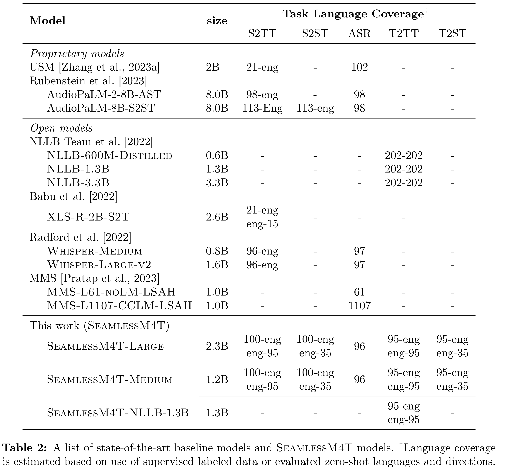
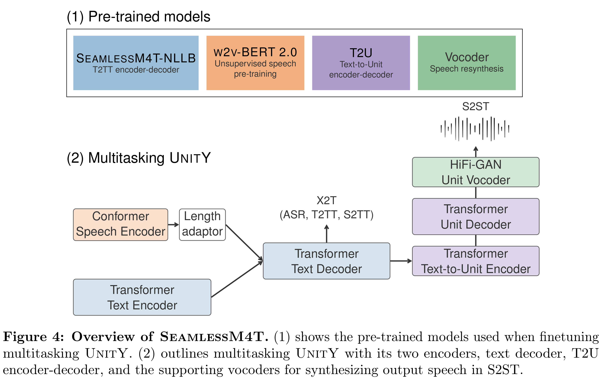

# SeamlessM4T: Massively Multilingual & Multimodal Machine Translation

[Official source](https://arxiv.org/abs/2308.11596)

## Abstract

What does it take to create the Babel Fish, a tool that can help individuals translate speech between any two languages? While recent breakthroughs in text-based models have pushed machine translation coverage beyond 200 languages, unified speech-to-speech translation models have yet to achieve similar strides. More specifically, conventional speech-to-speech translation systems rely on cascaded systems composed of multiple subsystems performing translation progressively, putting scalable and high-performing unified speech translation systems out of reach. To address these gaps, we introduce SeamlessM4T—Massively Multilingual & Multimodal Machine Translation—a single model that supports speech- to-speech translation, speech-to-text translation, text-to-speech translation, text-to-text translation, and automatic speech recognition for up to 100 languages. To build this, we used 1 million hours of open speech audio data to learn self-supervised speech representations with w2v-BERT 2.0. Subsequently, we created a multimodal corpus of automatically aligned speech translations, dubbed SeamlessAlign. Filtered and combined with human- labeled and pseudo-labeled data (totaling 406,000 hours), we developed the first multilingual system capable of translating from and into English for both speech and text. On Fleurs, SeamlessM4T sets a new standard for translations into multiple target languages, achieving an improvement of 20% BLEU over the previous state-of-the-art in direct speech-to-text translation. Compared to strong cascaded models, SeamlessM4T improves the quality of into-English translation by 1.3 BLEU points in speech-to-text and by 2.6 ASR-BLEU points in speech-to-speech. On CVSS and compared to a 2-stage cascaded model for speech- to-speech translation, SeamlessM4T-Large’s performance is stronger by 58%. Preliminary

human evaluations of speech-to-text translation outputs evinced similarly impressive results; for translations from English, XSTS scores for 24 evaluated languages are consistently above 4 (out of 5). For into English directions, we see significant improvement over Whisper- Large-v2’s baseline for 7 out of 24 languages. To further evaluate our system, we developed Blaser 2.0, which enables evaluation across speech and text with similar accuracy compared to its predecessor when it comes to quality estimation. Tested for robustness, our system performs better against background noises and speaker variations in speech-to-text tasks (average improvements of 38% and 49%, respectively) compared to the current state-of-the-art model. Critically, we evaluated SeamlessM4T on gender bias and added toxicity to assess translation safety. Compared to the state-of-the-art, we report up to 63% reduction in added toxicity in our translation outputs. Finally, all contributions in this work—including models, inference code, finetuning recipes backed by our improved modeling toolkit Fairseq2, and metadata to recreate the unfiltered 470,000 hours of SeamlessAlign —are open-sourced and accessible at https://github.com/facebookresearch/seamless_communication.

Table 2: A list of state-of-the-art baseline models and SeamlessM4T models. †Language coverage
is estimated based on use of supervised labeled data or evaluated zero-shot languages and directions.

p. 6

Figure 4: Overview of SeamlessM4T. (1) shows the pre-trained models used when finetuning
multitasking UnitY. (2) outlines multitasking UnitY with its two encoders, text decoder, T2U
encoder-decoder, and the supporting vocoders for synthesizing output speech in S2ST.

p. 28
