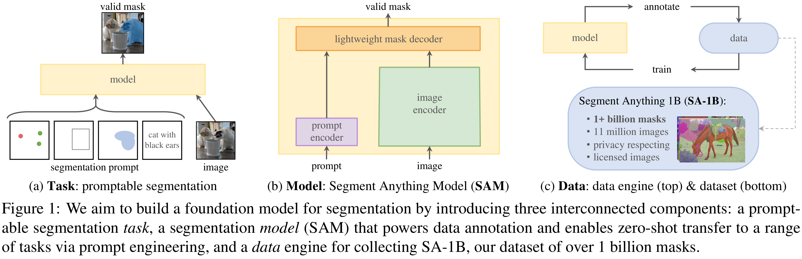

# Segment Anything

[Official source](https://arxiv.org/abs/2304.02643)

## Abstract

We introduce the Segment Anything (SA) project: a new task, model, and dataset for image segmentation. Using our efficient model in a data collection loop, we built the largest segmentation dataset to date (by far), with over 1 billion masks on 11M licensed and privacy respecting images. The model is designed and trained to be promptable, so it can transfer zero-shot to new image distributions and tasks. We evaluate its capabilities on numerous tasks and find that its zero-shot performance is impressive – often competitive with or even superior to prior fully supervised results. We are releasing the Segment Anything Model (SAM) and corresponding dataset (SA-1B) of 1B masks and 11M images at https://segment-anything.com to foster research into foundation models for computer vision.

Figure 1: We aim to build a foundation model for segmentation by introducing three interconnected components: a promptable segmentation task, a segmentation model (SAM) that powers data annotation and enables zero-shot transfer to a range of tasks via prompt engineering, and a data engine for collecting SA-1B, our dataset of over 1 billion masks.

p. 1
