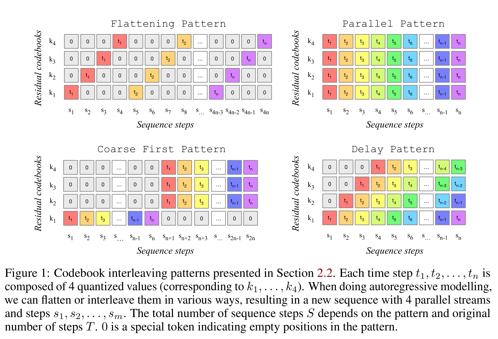
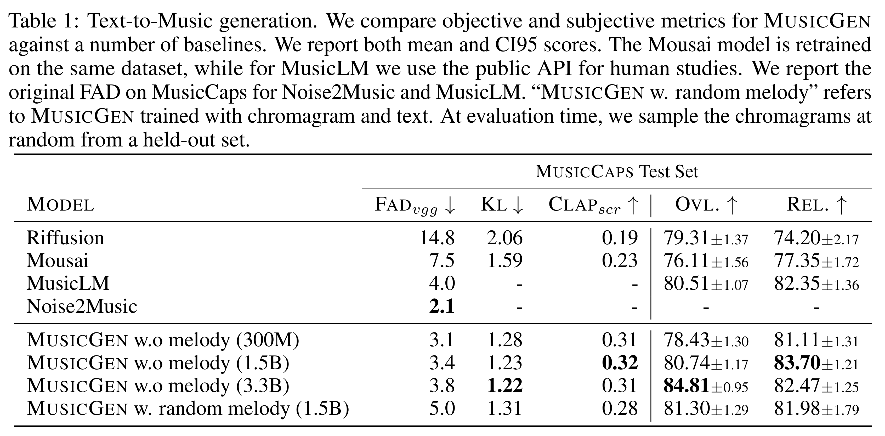

# Simple and Controllable Music Generation

[Official source](https://arxiv.org/abs/2306.05284)

## Abstract

We tackle the task of conditional music generation. We introduce MUSICGEN, a sin- gle Language Model (LM) that operates over several streams of compressed discrete music representation, i.e., tokens. Unlike prior work, MUSICGEN is comprised of a single-stage transformer LM together with efficient token interleaving patterns, which eliminates the need for cascading several models, e.g., hierarchically or up- sampling. Following this approach, we demonstrate how MUSICGEN can generate high-quality samples, both mono and stereo, while being conditioned on textual description or melodic features, allowing better controls over the generated output. We conduct extensive empirical evaluation, considering both automatic and human studies, showing the proposed approach is superior to the evaluated baselines on a standard text-to-music benchmark. Through ablation studies, we shed light over the importance of each of the components comprising MUSICGEN. Music samples, code, and models are available at github.com/facebookresearch/audiocraft.

Figure 1: Codebook interleaving patterns presented in Section 2.2. Each time step t1, t2, . . . , tn is composed of 4 quantized values (corresponding to k1, . . . , k4). When doing autoregressive modelling, we can flatten or interleave them in various ways, resulting in a new sequence with 4 parallel streams and steps s1, s2, . . . , sm. The total number of sequence steps S depends on the pattern and original number of steps T. 0 is a special token indicating empty positions in the pattern.

p. 2

Table 1: Text-to-Music generation. We compare objective and subjective metrics for MUSICGEN against a number of baselines. We report both mean and CI95 scores. The Mousai model is retrained on the same dataset, while for MusicLM we use the public API for human studies. We report the original FAD on MusicCaps for Noise2Music and MusicLM. “MUSICGEN w. random melody” refers to MUSICGEN trained with chromagram and text. At evaluation time, we sample the chromagrams at random from a held-out set.

p. 6
