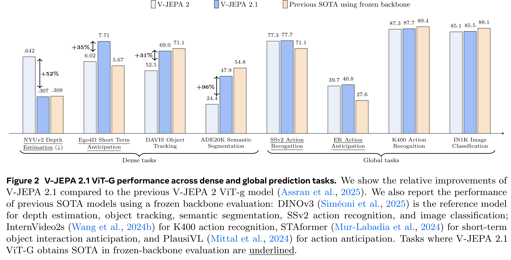
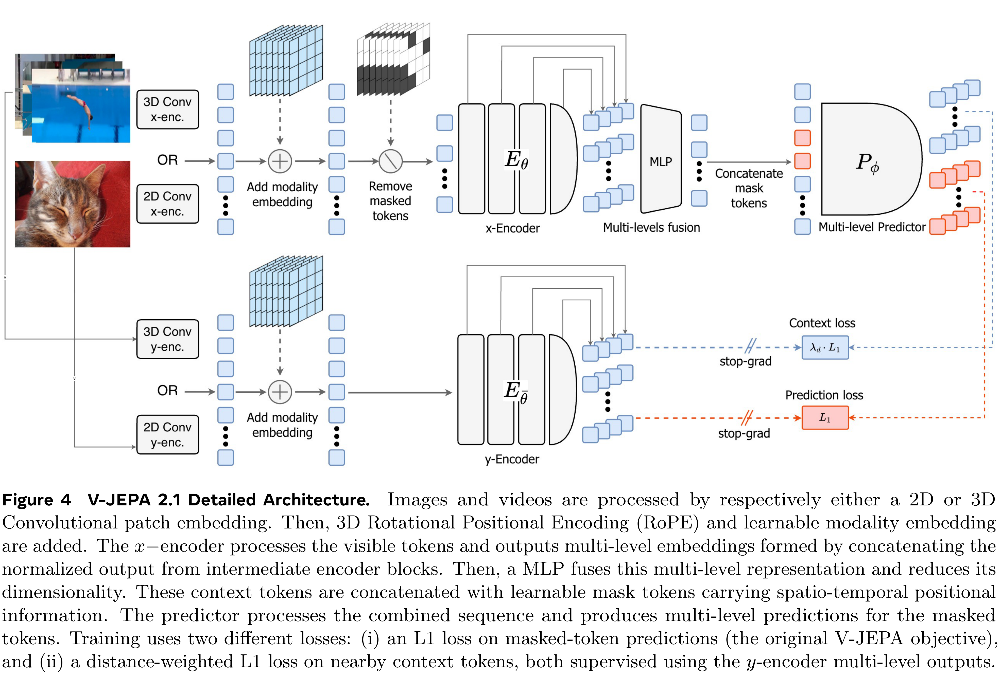
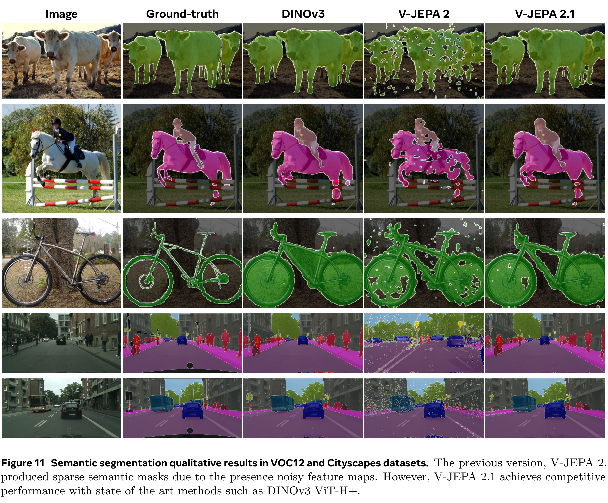

# V-JEPA 2.1: Unlocking Dense Features in Video Self-Supervised Learning

[Official source](https://arxiv.org/abs/2603.14482)

We present V-JEPA 2.1, a family of self-supervised models that learns dense, high-quality representations for visual scenes in both images and videos, while retaining strong global scene understanding. V-JEPA 2.1 combines four key ingredients: (i) a Dense Predictive Loss, a masking-based objective in which all tokens—visible context and masked tokens alike—contribute to the training loss, encouraging explicit spatial and temporal grounding; (ii) Deep Self-Supervision, which applies the self-supervised objective hierarchically at multiple intermediate encoder layers to improve representation quality ; (iii) Multi-Modal Tokenizers that support unified training over images and videos; and (iv) effective model and data scaling. These design choices substantially improve dense feature quality, yielding representations that are spatially structured, semantically coherent, and temporally consistent. . Empirically, V-JEPA 2.1 achieves state-of-the-art results on a range of benchmarks: 7.71 mAP on Ego4D for short-term object-interaction anticipation, 40.8 Recall@5 on EPIC-KITCHENS for high- level action anticipation, and a 20% improvement in real-robot grasping success rate over VJEPA-2 AC. The model also demonstrates state-of-art performances in robotic navigation (5.687 ATE on Tartan Drive), depth estimation (0.307 RMSE on NYUv2 with a linear probe), and global recognition (77.7% on Something-Something-V2). Our results demonstrate that V-JEPA 2.1 advances the state of the art in dense visual understanding and world modeling.

Figure 2 V-JEPA 2.1 ViT-G performance across dense and global prediction tasks. We show the relative improvements of V-JEPA 2.1 compared to the previous V-JEPA 2 ViT-g model ( Assran et al. , 2025 ). We also report the performance of previous SOTA models using a frozen backbone evaluation: DINOv3 ( Siméoni et al. , 2025 ) is the reference model for depth estimation, object tracking, semantic segmentation, SSv2 action recognition, and image classification; InternVideo2s ( Wang et al. , 2024b ) for K400 action recognition, STAformer ( Mur-Labadia et al. , 2024 ) for short-term object interaction anticipation, and PlausiVL ( Mittal et al. , 2024 ) for action anticipation. Tasks where V-JEPA 2.1 ViT-G obtains SOTA in frozen-backbone evaluation are underlined.

p. 2

Figure 4 V-JEPA 2.1 Detailed Architecture. Images and videos are processed by respectively either a 2D or 3D Convolutional patch embedding. Then, 3D Rotational Positional Encoding (RoPE) and learnable modality embedding are added. The x − encoder processes the visible tokens and outputs multi-level embeddings formed by concatenating the normalized output from intermediate encoder blocks. Then, a MLP fuses this multi-level representation and reduces its dimensionality. These context tokens are concatenated with learnable mask tokens carrying spatio-temporal positional information. The predictor processes the combined sequence and produces multi-level predictions for the masked tokens. Training uses two different losses: (i) an L1 loss on masked-token predictions (the original V-JEPA objective), and (ii) a distance-weighted L1 loss on nearby context tokens, both supervised using the y -encoder multi-level outputs.

p. 5

Figure 11 Semantic segmentation qualitative results in VOC12 and Cityscapes datasets. The previous version, V-JEPA 2, produced sparse semantic masks due to the presence noisy feature maps. However, V-JEPA 2.1 achieves competitive performance with state of the art methods such as DINOv3 ViT-H+.

p. 17
