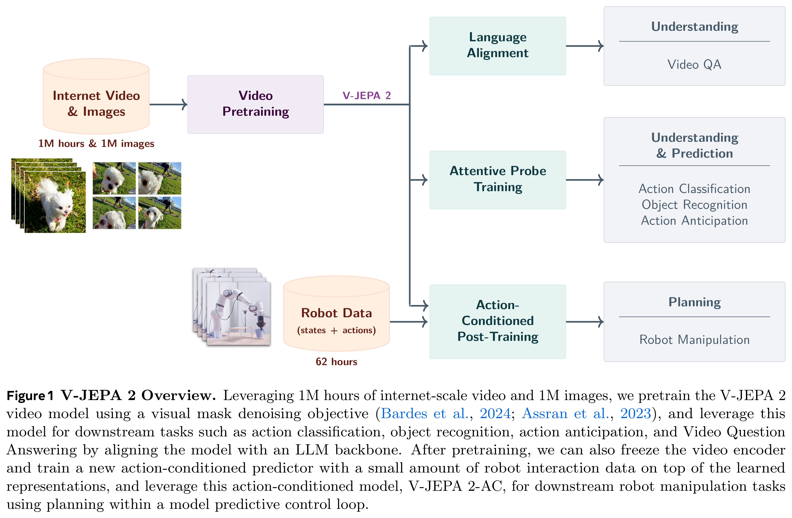
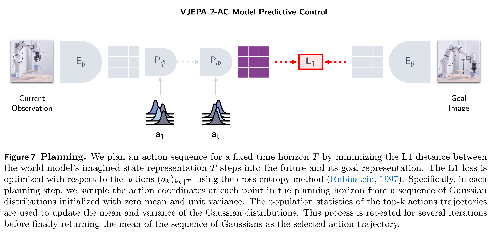
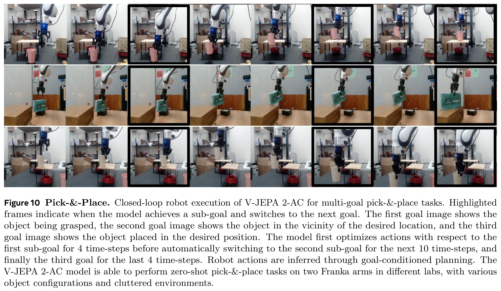

# V-JEPA 2: Self-Supervised Video Models Enable Understanding, Prediction and Planning

[Official source](https://arxiv.org/abs/2506.09985)

## 1 Introduction

Humans have the ability to adapt and generalize when taking on new tasks and operating in unfamiliar environments. Several cognitive learning theories suggest that humans learn an internal model of the world by integrating low-level sensory inputs to represent and predict future states (Craik, 1967; Rao and Ballard, 1999), and they further posit that this world model shapes our perception at any given moment, playing a crucial role in informing our understanding of reality (Friston, 2010; Clark, 2013; Nortmann et al., 2015). Moreover, our ability to predict the effects of our actions on future states of the world is also essential for goal-oriented planning (Sutton and Barto, 1981, 1998; Ha and Schmidhuber, 2018; Wolpert and Ghahramani, 2000). Building artificial agents that learn a world model from sensory data, such as video, could enable them to understand the physical world, predict future states, and effectively — like humans — plan in new situations, resulting in systems capable of tackling tasks that have not been encountered before.

Previous works have explored the development of predictive world models from interaction data consisting

of state-action sequences, often also relying on explicit reward feedback from the environment to infer goals (Sutton and Barto, 1981; Fragkiadaki et al., 2015; Ha and Schmidhuber, 2018; Hafner et al., 2019b; Hansen et al., 2022). However, the limited availability of real-world interaction data constrains the scalability of these methods. To address this limitation, more recent works have leveraged both internet-scale video and interaction data towards training action-conditioned video generation models for robot control, but only demonstrate limited results in robot execution using model-based control (Hu et al., 2023; Yang et al., 2024b; Bruce et al., 2024; Agarwal et al., 2025). In particular, this line of research often emphasizes the evaluation of the faithfulness of the predictions and visual quality instead of planning capabilities, perhaps due to the computational cost of planning by generating video.

In this work, we build upon the self-supervised hypothesis as a means to learn world models that capture background knowledge of the world largely from observation. Specifically, we leverage the joint-embedding predictive architecture (JEPA) (LeCun, 2022), which learns by making predictions in a learned representation space. In contrast to approaches that focus on learning entirely from interaction data, self-supervised learning enables us to make use of internet-scale video — depicting sequences of states without direct observations of the actions — to learn to both represent video observations and learn a predictive model for world dynamics in this learned representation space. Furthermore, in contrast to approaches based on video generation, the JEPA approach focuses on learning representations for predictable aspects of a scene (e.g., the trajectory of an object in motion) while ignoring unpredictable details that generative objectives emphasize, since they make pixel-level predictions (e.g., the precise location of each blade of grass in a field, or each leaf on a tree). By scaling JEPA pretraining, we demonstrate that it yields video representations with state-of-the-art understanding and prediction capabilities, and that such representations can be leveraged as a basis for action-conditioned predictive models and enable zero-shot planning.

Our approach, V-JEPA 2, utilizes a stage-wise training procedure, beginning with action-free pre-training on internet-scale video, followed by post-training with a small amount of interaction data (see Figure 1). In the first stage, we use a mask-denoising feature prediction objective (Assran et al., 2023; Bardes et al., 2024), where the model predicts masked segments of a video in a learned representation space. We train

the V-JEPA 2 encoder with up to 1 billion parameters and with more than 1 million hours of video. Our experiments confirm that scaling self-supervised video pretraining enhances the encoder’s ability to achieve visual understanding, including broad motion and appearance recognition capabilities, through probe-based evaluations and by aligning the encoder with a language model for video question-answering (Krojer et al., 2024; Pătrăucean et al., 2023; Liu et al., 2024c; Cai et al., 2024; Shangguan et al., 2024).

Following pretraining on internet-scale video, we train an action-conditioned world model, V-JEPA 2-AC, on a small set of interaction data using the representations learned in the first stage. Our action-conditioned world model is a 300M-parameter transformer network employing a block-causal attention mechanism, which autoregressively predicts the representation of the next video frame conditioned on an action and previous states. With as little as 62 hours of unlabeled interaction data from the Droid dataset (Khazatsky et al., 2024), we demonstrate the feasibility of training a latent world model that, given sub-goals, can be leveraged to plan actions on a Franka robot arm and perform prehensile manipulation tasks from a monocular RGB camera zero-shot in a new environment.

To summarize, we show that joint-embedding predictive architectures learning from videos can be used to build a world model that enables understanding the physical world, predicting future states, and effectively planning in new situations; this is achieved by leveraging internet-scale video and a small amount of interaction data. Specifically:

• Understanding — Probe-based Classification: Scaling self-supervised video pretraining results in video representations applicable to many tasks. V-JEPA 2 excels at encoding fine-grained motion information, achieving strong performance on tasks requiring motion understanding, such as Something-Something v2, with 77.3 top-1 accuracy using an attentive probe.

• Understanding — Video Question-Answering: V-JEPA 2 encoder can be used to train a multi-modal large language model, to tackle video-question answering tasks. We observe state-of-the-art performance on 8B language model class on multiple benchmarks that require physical world understanding and temporal reasoning, such as MVP (44.5 paired accuracy), PerceptionTest (84.0 test set accuracy), TempCompass (76.9 multi-choice accuracy), TemporalBench (36.7 multi-binary short-QA accuracy) and TOMATO (40.3 accuracy). In particular, we show that a video encoder pre-trained without language supervision can be aligned with a language model and achieve state-of-the-art performance, contrary to conventional wisdom (Yuan et al., 2025; Wang et al., 2024b).

• Prediction: Large-scale self-supervised video pretraining enhances prediction capabilities. V-JEPA 2 achieves state-of-the-art performance on the Epic-Kitchens-100 human-action anticipation task using an attentive probe, with 39.7 recall-at-5, which is a 44% relative improvement over the previous best model. • Planning: We demonstrate that V-JEPA 2-AC, obtained by post-training V-JEPA 2 with only 62 hours of unlabeled robot manipulation data from the popular Droid dataset, can be deployed in new environments to solve prehensile manipulation tasks using planning with given subgoals. Without training on any additional data from robots in our labs, and without any task-specific training or reward, the model successfully handles prehensile manipulation tasks, such as Grasp and Pick-and-Place with novel objects and in new environments.

The remainder of this paper is organized as follows. Section 2 describes the V-JEPA 2 pretraining procedure, including the key ingredients enabling scaling beyond the original V-JEPA recipe of Bardes et al. (2024). Section 3 then introduces our approach to training a task-agnostic action-conditioned world model, V-JEPA 2- AC, leveraging the pretrained V-JEPA 2 model. Section 4 demonstrates using V-JEPA 2-AC for robot control via model-based planning. Because V-JEPA 2-AC models world dynamics in a learned representation space, its capabilities fundamentally depend on the information captured in the V-JEPA 2 representation space, and so we further explore the performance of V-JEPA 2 for video understanding in Section 5 and prediction tasks in Section 6. Finally, in Section 7 we show that V-JEPA 2 can be aligned with a language model for video question answering. Section 8 discusses related work, and we conclude in Section 9.

Figure 1 V-JEPA 2 Overview. Leveraging 1M hours of internet-scale video and 1M images, we pretrain the V-JEPA 2
video model using a visual mask denoising objective (Bardes et al., 2024; Assran et al., 2023), and leverage this
model for downstream tasks such as action classification, object recognition, action anticipation, and Video Question
Answering by aligning the model with an LLM backbone. After pretraining, we can also freeze the video encoder
and train a new action-conditioned predictor with a small amount of robot interaction data on top of the learned
representations, and leverage this action-conditioned model, V-JEPA 2-AC, for downstream robot manipulation tasks
using planning within a model predictive control loop.

p. 2

Figure 7 Planning. We plan an action sequence for a fixed time horizon T by minimizing the L1 distance between
the world model’s imagined state representation T steps into the future and its goal representation. The L1 loss is
optimized with respect to the actions (ak)k∈[T ] using the cross-entropy method (Rubinstein, 1997). Specifically, in each
planning step, we sample the action coordinates at each point in the planning horizon from a sequence of Gaussian
distributions initialized with zero mean and unit variance. The population statistics of the top-k actions trajectories
are used to update the mean and variance of the Gaussian distributions. This process is repeated for several iterations
before finally returning the mean of the sequence of Gaussians as the selected action trajectory.

p. 11

Figure 10 Pick-&-Place. Closed-loop robot execution of V-JEPA 2-AC for multi-goal pick-&-place tasks. Highlighted
frames indicate when the model achieves a sub-goal and switches to the next goal. The first goal image shows the
object being grasped, the second goal image shows the object in the vicinity of the desired location, and the third
goal image shows the object placed in the desired position. The model first optimizes actions with respect to the
first sub-goal for 4 time-steps before automatically switching to the second sub-goal for the next 10 time-steps, and
finally the third goal for the last 4 time-steps. Robot actions are inferred through goal-conditioned planning. The
V-JEPA 2-AC model is able to perform zero-shot pick-&-place tasks on two Franka arms in different labs, with various
object configurations and cluttered environments.

p. 14
