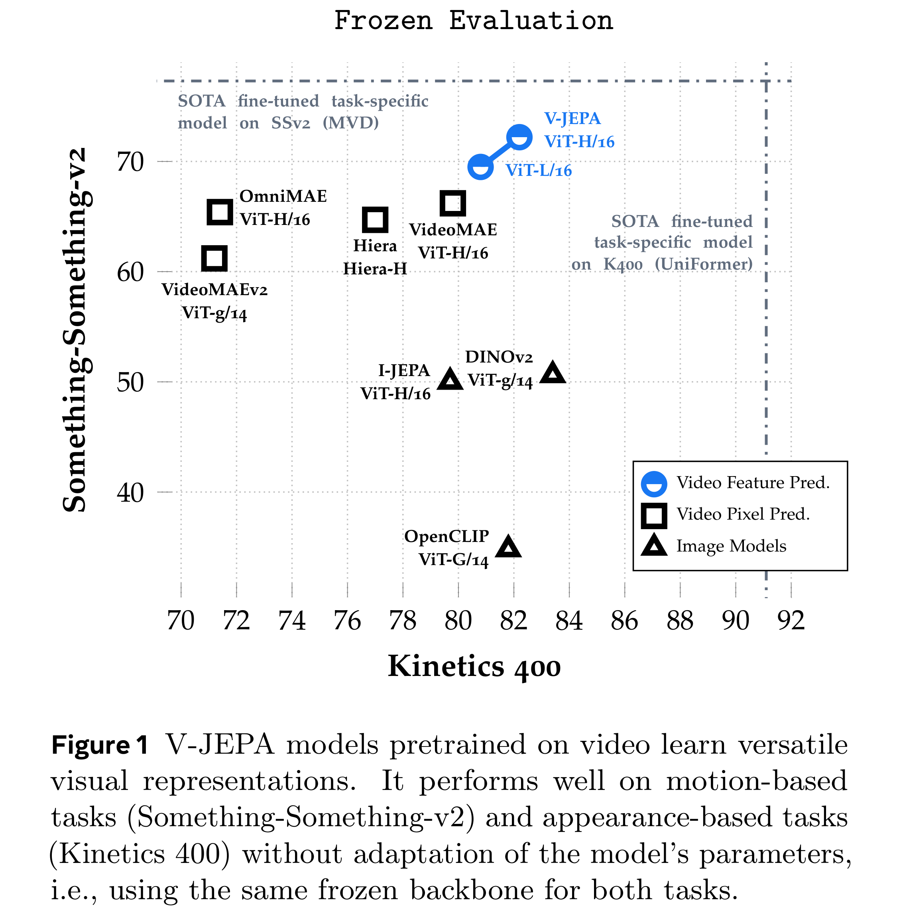

# Revisiting Feature Prediction for Learning Visual Representations from Video

[Official source](https://arxiv.org/abs/2404.08471)

This paper explores feature prediction as a stand-alone objective for unsupervised learning from video and introduces V-JEPA, a collection of vision models trained solely using a feature prediction objective, without the use of pretrained image encoders, text, negative examples, reconstruction, or other sources of supervision. The models are trained on 2 million videos collected from public datasets and are evaluated on downstream image and video tasks. Our results show that learning by predicting video features leads to versatile visual representations that perform well on both motion and appearance-based tasks, without adaption of the model’s parameters; e.g., using a frozen backbone. Our largest model, a ViT-H/16 trained only on videos, obtains 81.9% on Kinetics-400, 72.2% on Something-Something-v2, and 77.9% on ImageNet1K.

Figure 1 V-JEPA models pretrained on video learn versatile visual representations. It performs well on motion-based tasks (Something-Something-v2) and appearance-based tasks (Kinetics 400) without adaptation of the model’s parameters, i.e., using the same frozen backbone for both tasks.

p. 1
