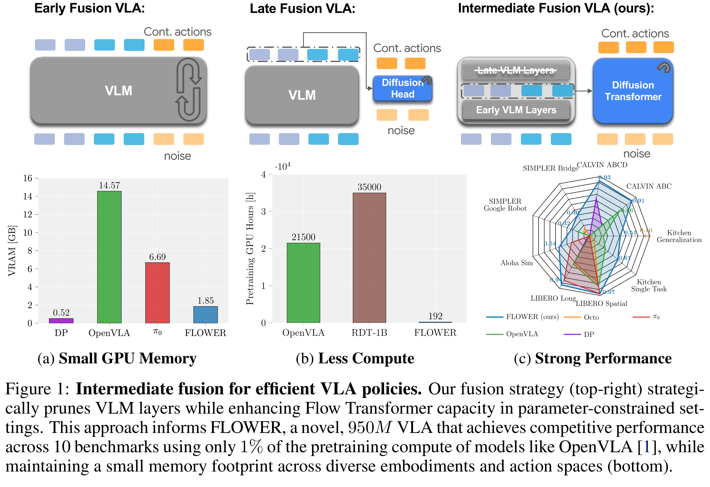
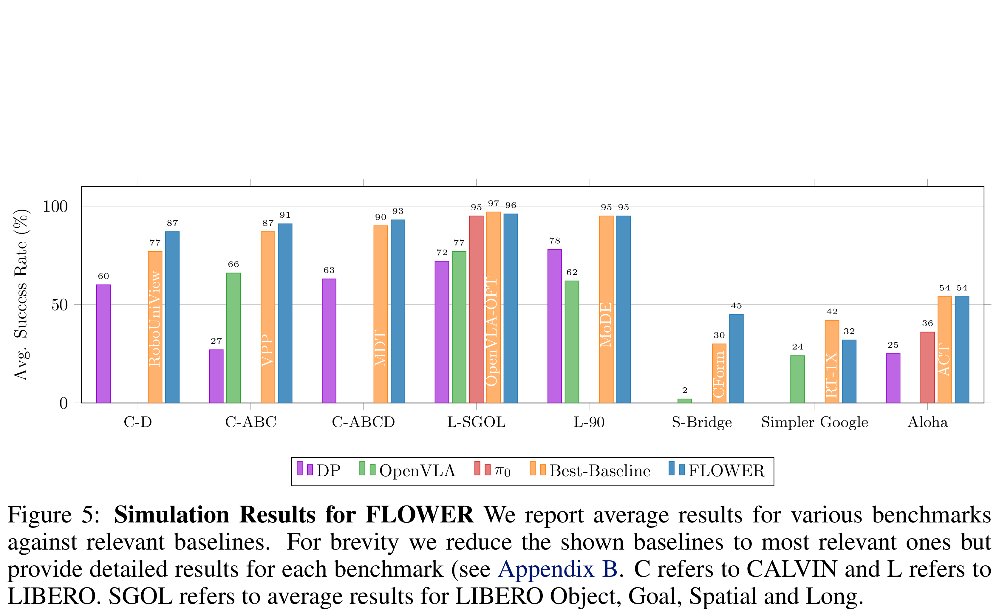

# FLOWER: Democratizing Generalist Robot Policies with Efficient Vision-Language-Action Flow Policies

[Official source](https://arxiv.org/abs/2509.04996)

## Abstract:

Developing efficient Vision-Language-Action (VLA) policies is cru- cial for practical robotics deployment, yet current approaches face prohibitive computational costs and resource requirements. Existing diffusion-based VLA policies require multi-billion-parameter models and massive datasets to achieve strong performance. We tackle this efficiency challenge with two contributions: intermediate-modality fusion, which reallocates capacity to the diffusion head by pruning up to 50% of LLM layers, and action-specific Global-AdaLN con- ditioning, which cuts parameters by 20% through modular adaptation. We in- tegrate these advances into a novel 950 M-parameter VLA called FLOWER. Pretrained in just 200 H100 GPU hours, FLOWER delivers competitive perfor- mance with bigger VLAs across 190 tasks spanning ten simulation and real- world benchmarks and demonstrates robustness across diverse robotic embodi- ments. In addition, FLOWER achieves a new SoTA of 4.53 on the CALVIN ABC benchmark. Demos, code and pretrained weights are available at https: //intuitive-robots.github.io/flower_vla/.

Keywords: Imitation Learning, VLA,Language-conditioned Manipulation

Figure 1: Intermediate fusion for efficient VLA policies. Our fusion strategy (top-right) strategi- cally prunes VLM layers while enhancing Flow Transformer capacity in parameter-constrained set- tings. This approach informs FLOWER, a novel, 950M VLA that achieves competitive performance across 10 benchmarks using only 1% of the pretraining compute of models like OpenVLA [1], while maintaining a small memory footprint across diverse embodiments and action spaces (bottom).

p. 2

Figure 5: Simulation Results for FLOWER We report average results for various benchmarks against relevant baselines. For brevity we reduce the shown baselines to most relevant ones but provide detailed results for each benchmark (see Appendix B. C refers to CALVIN and L refers to LIBERO. SGOL refers to average results for LIBERO Object, Goal, Spatial and Long.

p. 7
