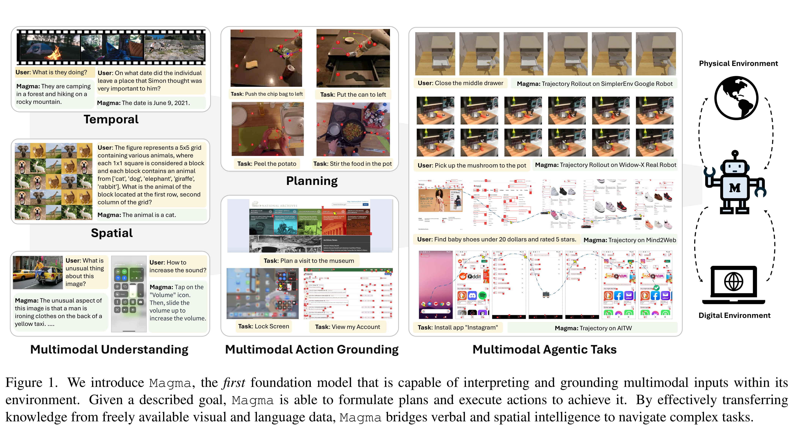
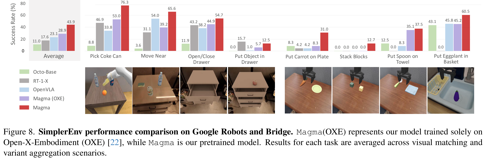

# Magma: A Foundation Model for Multimodal AI Agents

[Official source](https://arxiv.org/abs/2502.13130)

## Abstract

We present Magma, a foundation model that serves mul- timodal AI agentic tasks in both the digital and physical worlds. Magma is a significant extension of vision-language (VL) models in that it not only retains the VL understand- ing ability (verbal intelligence) of the latter, but is also equipped with the ability to plan and act in the visual- spatial world (spatial-temporal intelligence) and complete agentic tasks ranging from UI navigation to robot manip- ulation. To endow the agentic capabilities, Magma is pre- trained on large amounts of heterogeneous datasets span- ning from images, videos to robotics data, where the action- able visual objects (e.g., clickable buttons in GUI) in images are labeled by Set-of-Mark (SoM) for action grounding, and

the object movements (e.g., the trace of human hands or robotic arms) in videos are labeled by Trace-of-Mark (ToM) for action planning. Extensive experiments show that SoM and ToM reach great synergy and facilitate the acquisi- tion of spatial-temporal intelligence for our Magma model, which is fundamental to a wide range of tasks as shown in Fig. 1. In particular, Magma creates new state-of-the-art re- sults on UI navigation and robotic manipulation tasks, out- performing previous models that are specifically tailored to these tasks. On image and video-related multimodal tasks, Magma also compares favorably to popular large multi- modal models that are trained on much larger datasets. We make our model and code public for reproducibility1.

Figure 1. We introduce Magma, the first foundation model that is capable of interpreting and grounding multimodal inputs within its environment. Given a described goal, Magma is able to formulate plans and execute actions to achieve it. By effectively transferring knowledge from freely available visual and language data, Magma bridges verbal and spatial intelligence to navigate complex tasks.

p. 1

Figure 8. SimplerEnv performance comparison on Google Robots and Bridge. Magma(OXE) represents our model trained solely on Open-X-Embodiment (OXE) [22], while Magma is our pretrained model. Results for each task are averaged across visual matching and variant aggregation scenarios.

p. 9
