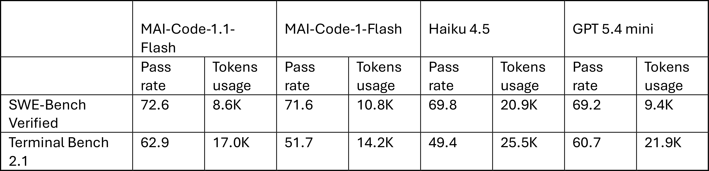
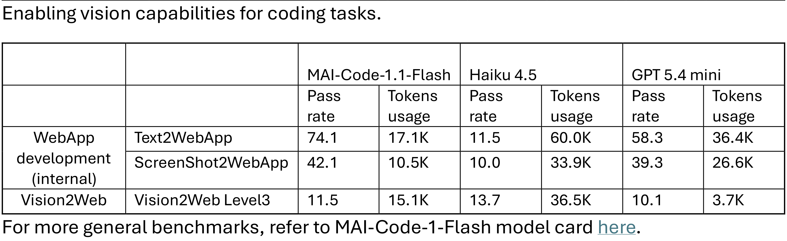

# MAI-Code-1.1-Flash Model Card

[Official source](https://microsoft.ai/models/mai-code-1-flash/)

## Description

MAI-Code-1.1-Flash is a text-to-text and image-to-text coding model built for fast, efficient assistance in everyday developer workflows. The model is optimized to deliver high-quality coding help with low latency and low serving cost, making it well-suited for tasks such as agentic coding in real repositories, repository question answering, refactoring, and tool-using developer scenarios.

p. 5

p. 5
