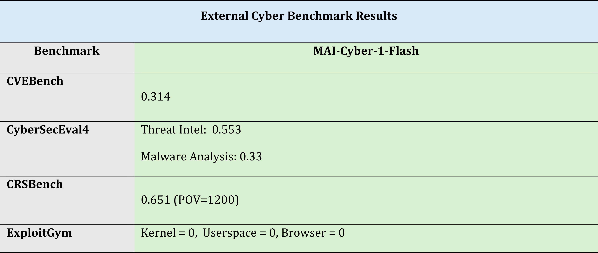

# MAI-Cyber-1-Flash Model Card

[Official source](https://microsoft.ai/models/mai-cyber-1-flash/)

## 1. Model overview

MAI-Cyber-1-Flash is Microsoft’s specialized cyber defense model with 5 billion active parameters, built for agentic security workflows. Developed using real-world executable security environments, the model helps organizations identify, prioritize, and remediate vulnerabilities across modern codebases at enterprise scale within codename MDASH.

## 3.1 Benchmarking methodology

MAI-Cyber-1-Flash was primarily evaluated as a single model using a lightweight terminal harness to understand its standalone capabilities. Benchmarks were run on the release checkpoint, which includes RAI safety training in the model weights.

p. 5

p. 5
