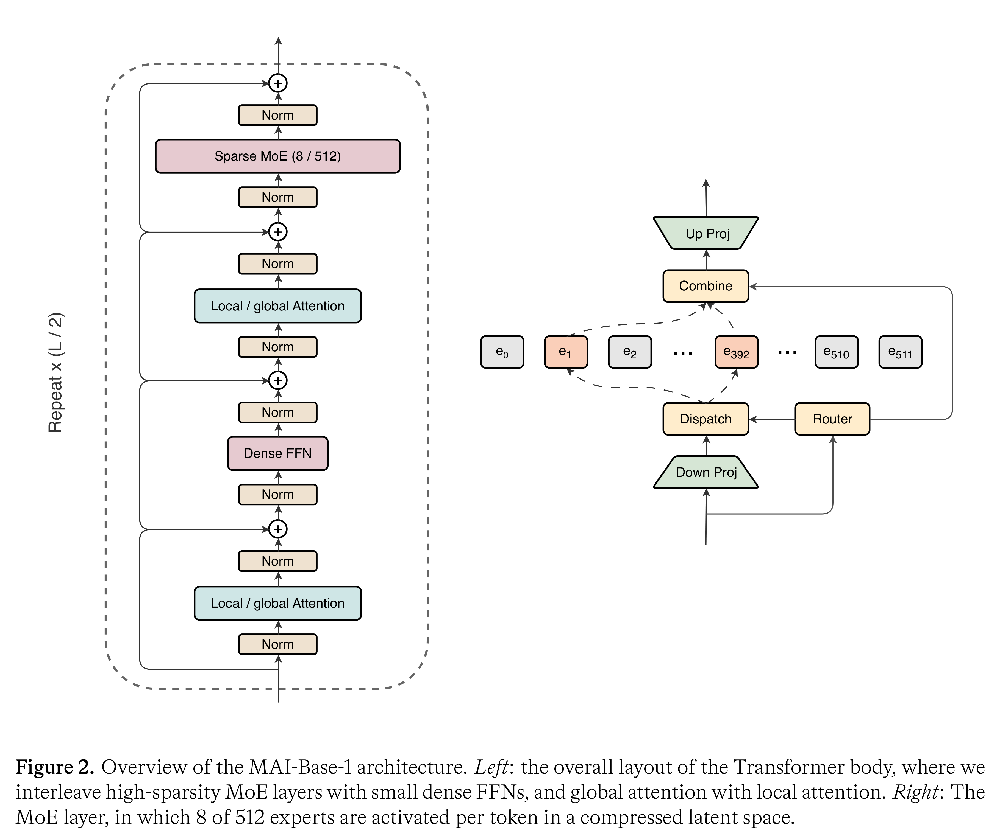
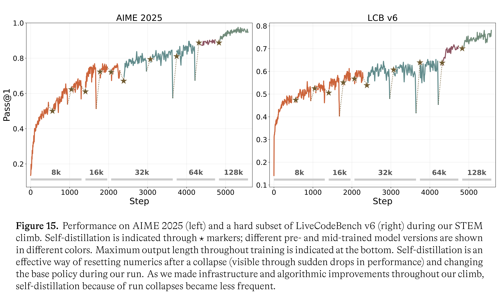

# MAI-Thinking-1: Building a Hill-Climbing Machine

[Official source](https://microsoft.ai/models/mai-thinking-1/)

## Abstract

Progress in AI is driven not by a single model, but by the ability to continually improve upon the current state of models. Achieving this requires treating model development as a system-level optimization problem, for which the solution is building a hill-climbing machine for rapid improvement. Our process includes a scaling-focused framework for pre-training modeling decisions, as well as a robust reinforcement learning recipe and infrastructure that sustains long, log-linear performance improvement. The first model developed using our process is MAI-Thinking-1, a 35B active / 1T total parameter MoE that stands among the strongest models of similar size on STEM reasoning and coding tasks (e.g., 52.8% on SWE-Bench Pro, 97.0% on AIME 2025, and 87.7% on LiveCodeBench v6). MAI-Thinking-1 is trained from-scratch, exclusively on clean, enterprise-grade data, without distillation from third-party models. In this technical report, we offer a deep dive into the development of MAI-Thinking-1. By sharing our technical details and learnings we hope to cultivate a transparent and science-driven approach to further development in AI.

Figure 2. Overview of the MAI-Base-1 architecture. Left: the overall layout of the Transformer body, where we interleave high-sparsity MoE layers with small dense FFNs, and global attention with local attention. Right: The MoE layer, in which 8 of 512 experts are activated per token in a compressed latent space.

p. 5

Figure 15. Performance on AIME 2025 (left) and a hard subset of LiveCodeBench v6 (right) during our STEM climb. Self-distillation is indicated through ⋆markers; different pre- and mid-trained model versions are shown in different colors. Maximum output length throughout training is indicated at the bottom. Self-distillation is an effective way of resetting numerics after a collapse (visible through sudden drops in performance) and changing the base policy during our run. As we made infrastructure and algorithmic improvements throughout our climb, self-distillation because of run collapses became less frequent.

p. 35
