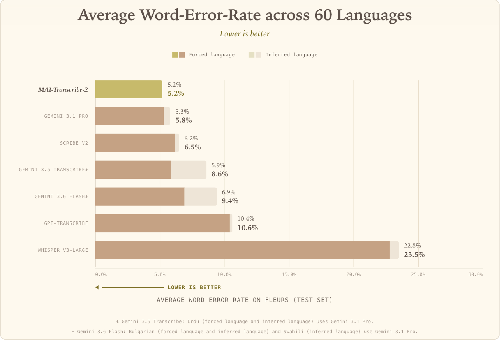

# MAI-Transcribe-2 Model Card

[Official source](https://microsoft.ai/models/mai-transcribe-2/)

## Overview

About this model

MAI-Transcribe-2 is a speech-to-text model built in-house by the Microsoft AI team, delivering reliable

transcription across 60 languages. It powers video captions, meeting transcription, clinical and call center

documentation, accessibility tools, content creation workflows, and voice agents. Beyond raw transcription,

this generation adds speaker diarization to separate and label multiple speakers in a single recording, and

word-level timestamps that pinpoint exactly who spoke and when. Keyword biasing makes transcription

domain-aware, improving recognition of specialized vocabulary.

Key capabilities

Best-in-class transcription accuracy across 60 languages.

Speaker diarization: identifies and separates multiple speakers within the same audio recording.

Word-level timestamps: precise timing for every word, enabling alignment, search, and editing workflows.

Robust in noisy, real-world conditions.

Faster inference with substantially lower latency, especially for long-form audio, with up to 10× faster processing than competitors.

Automatic language identification.

Keyword biasing to handle domain specific terminology, abbreviations or disambiguating terms.

Configurable transcription style: verbatim captures speech exactly as spoken, including fillers and false

starts, for compliance and analysis workloads; clean removes disfluencies for readable captions, notes,

and published transcripts.

## Overview

MAI-Transcribe-2 is a speech-to-text model built in-house by the Microsoft AI team, delivering reliable transcription across 60 languages. It powers video captions, meeting transcription, clinical and call center documentation, accessibility tools, content creation workflows, and voice agents.

p. 1

p. 2
