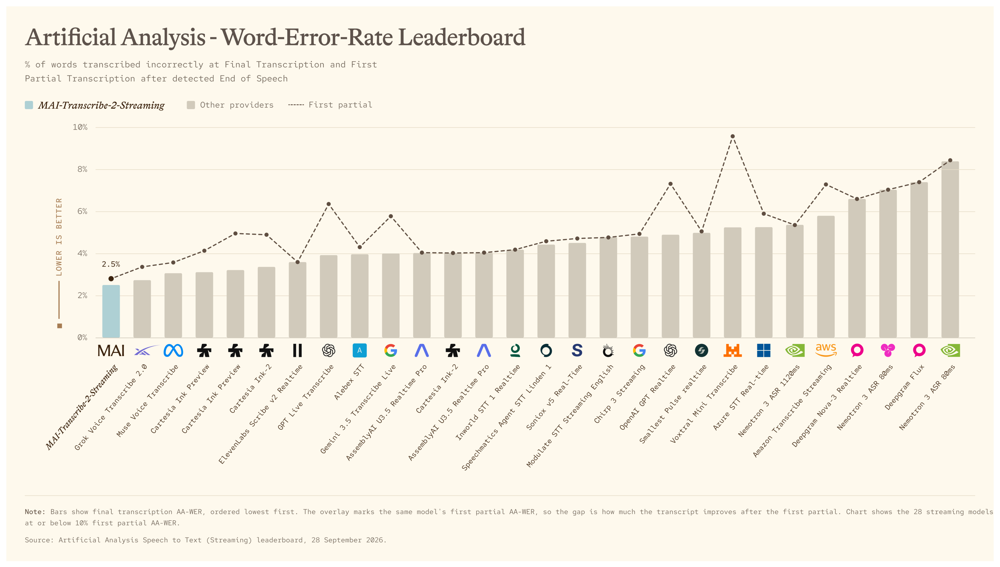

# MAI-Transcribe-2-Streaming Model Card

[Official source](https://microsoft.ai/news/our-first-streaming-transcription-model/)

## Overview

MAI-Transcribe-2-Streaming is a low-latency streaming speech recognition model built in-house by the Microsoft AI team that turns live audio into text as it is spoken. It continuously processes an audio stream and emits fast partial hypotheses followed by stable final results, so applications can respond while a person is still talking. This incremental output is well suited to live captions, voice agents, dictation, call experiences, and other interactive products where waiting for a complete recording would introduce unacceptable delay. It delivers reliable recognition across 60 languages and is designed to remain effective across varied accents, speaking styles, and real-world audio conditions.

## Overview

MAI-Transcribe-2-Streaming is a low-latency streaming speech recognition model built in-house by the Microsoft AI team that turns live audio into text as it is spoken. It continuously processes an audio stream and emits fast partial hypotheses followed by stable final results, so applications can respond while a person is still talking.

p. 1

p. 2
