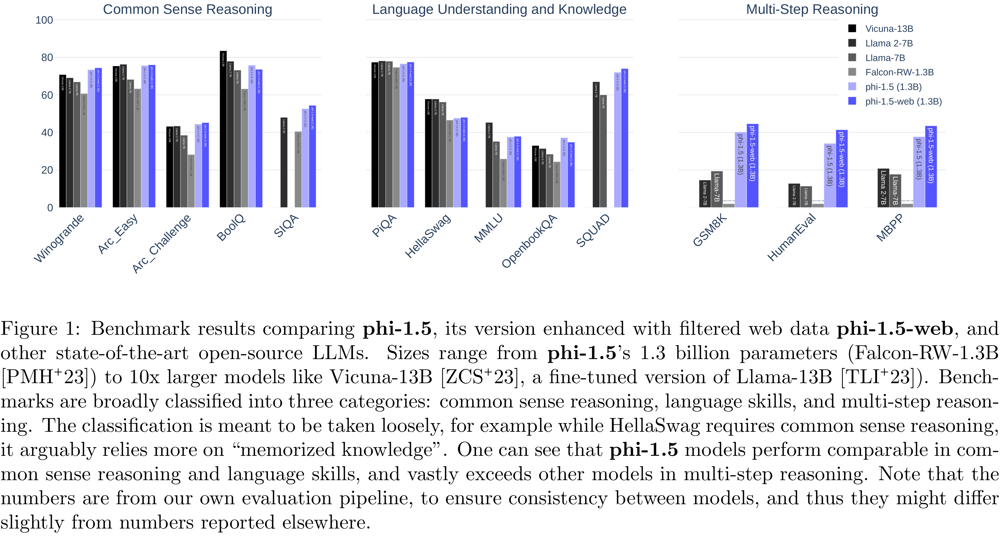

# Textbooks Are All You Need II: phi-1.5 technical report

[Official source](https://www.microsoft.com/en-us/research/publication/textbooks-are-all-you-need-ii-phi-1-5-technical-report/)

## Abstract

We continue the investigation into the power of smaller Transformer-based language models as initiated by TinyStories – a 10 million parameter model that can produce coherent English – and the follow-up work on phi-1, a 1.3 billion parameter model with Python coding performance close to the state-of-the-art. The latter work proposed to use existing Large Language Models (LLMs) to generate “textbook quality” data as a way to enhance the learning process compared to traditional web data. We follow the “Textbooks Are All You Need” approach, focusing this time on common sense reasoning in natural language, and create a new 1.3 billion parameter model named phi-1.5, with performance on natural language tasks comparable to models 5x larger, and surpassing most non-frontier LLMs on more complex reasoning tasks such as grade-school mathematics and basic coding. More generally, phi-1.5 exhibits many of the traits of much larger LLMs, both good –such as the ability to “think step by step” or perform some rudimentary in-context learning– and bad, including hallucinations and the potential for toxic and biased generations –encouragingly though, we are seeing improvement on that front thanks to the absence of web data. We open-source phi-1.5 to promote further research on these urgent topics.

Figure 1: Benchmark results comparing phi-1.5, its version enhanced with filtered web data phi-1.5-web, and other state-of-the-art open-source LLMs. Sizes range from phi-1.5’s 1.3 billion parameters (Falcon-RW-1.3B [PMH+23]) to 10x larger models like Vicuna-13B [ZCS+23], a fine-tuned version of Llama-13B [TLI+23]). Benchmarks are broadly classified into three categories: common sense reasoning, language skills, and multi-step reasoning. The classification is meant to be taken loosely, for example while HellaSwag requires common sense reasoning, it arguably relies more on “memorized knowledge”. One can see that phi-1.5 models perform comparable in common sense reasoning and language skills, and vastly exceeds other models in multi-step reasoning. Note that the numbers are from our own evaluation pipeline, to ensure consistency between models, and thus they might differ slightly from numbers reported elsewhere.

p. 1
