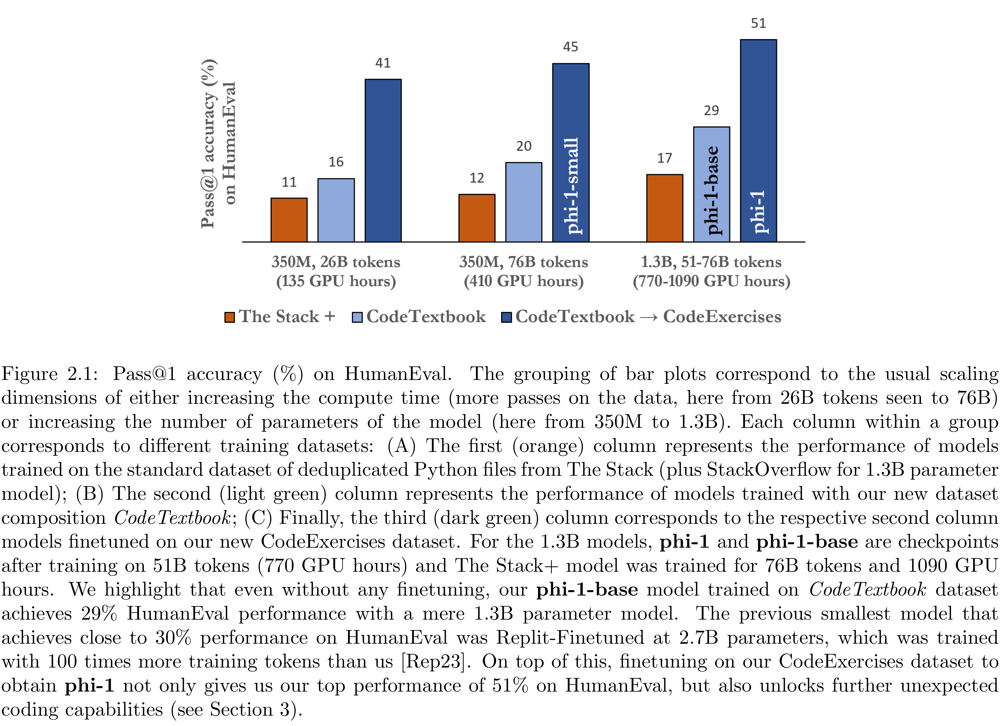

# Textbooks Are All You Need

[Official source](https://arxiv.org/abs/2306.11644)

## Abstract

We introduce phi-1, a new large language model for code, with significantly smaller size than competing models: phi-1 is a Transformer-based model with 1.3B parameters, trained for 4 days on 8 A100s, using a selection of “textbook quality” data from the web (6B tokens) and synthetically generated textbooks and exercises with GPT-3.5 (1B tokens). Despite this small scale, phi-1 attains pass@1 accuracy 50.6% on HumanEval and 55.5% on MBPP. It also displays surprising emergent properties compared to phi-1-base, our model before our finetuning stage on a dataset of coding exercises, and phi-1-small, a smaller model with 350M parameters trained with the same pipeline as phi-1 that still achieves 45% on HumanEval.

Figure 2.1: Pass@1 accuracy (%) on HumanEval. The grouping of bar plots correspond to the usual scaling dimensions of either increasing the compute time (more passes on the data, here from 26B tokens seen to 76B) or increasing the number of parameters of the model (here from 350M to 1.3B). Each column within a group corresponds to different training datasets: (A) The first (orange) column represents the performance of models trained on the standard dataset of deduplicated Python files from The Stack (plus StackOverflow for 1.3B parameter model); (B) The second (light green) column represents the performance of models trained with our new dataset composition CodeTextbook; (C) Finally, the third (dark green) column corresponds to the respective second column models finetuned on our new CodeExercises dataset. For the 1.3B models, phi-1 and phi-1-base are checkpoints after training on 51B tokens (770 GPU hours) and The Stack+ model was trained for 76B tokens and 1090 GPU hours. We highlight that even without any finetuning, our phi-1-base model trained on CodeTextbook dataset achieves 29% HumanEval performance with a mere 1.3B parameter model. The previous smallest model that achieves close to 30% performance on HumanEval was Replit-Finetuned at 2.7B parameters, which was trained with 100 times more training tokens than us [Rep23]. On top of this, finetuning on our CodeExercises dataset to obtain phi-1 not only gives us our top performance of 51% on HumanEval, but also unlocks further unexpected coding capabilities (see Section 3).

p. 3
