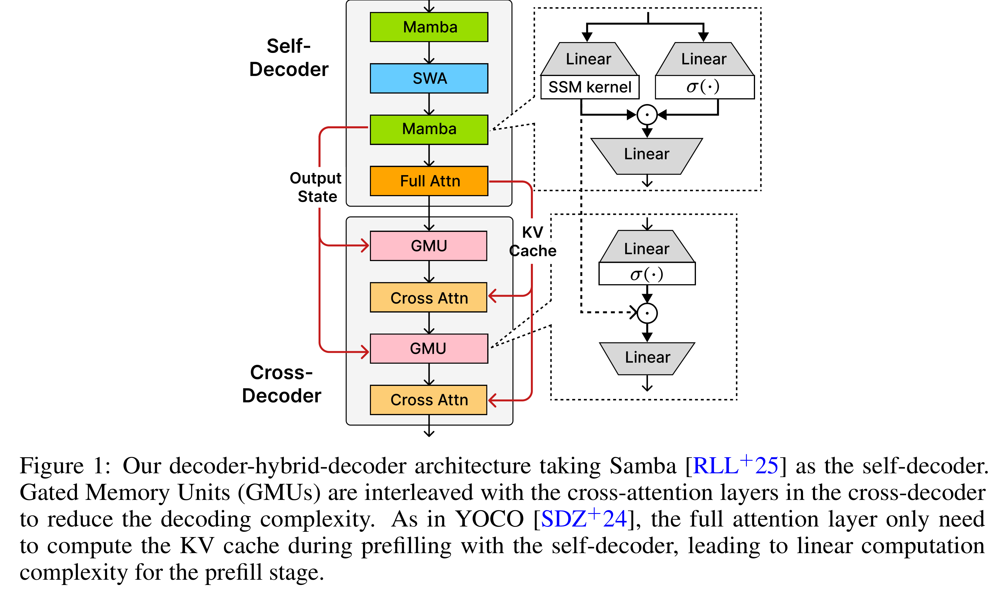

# Decoder-Hybrid-Decoder Architecture for Efficient Reasoning with Long Generation

[Official source](https://huggingface.co/microsoft/Phi-4-mini-flash-reasoning)

## Abstract

Recent advances in language modeling have demonstrated the effectiveness of State Space Models (SSMs) for efficient sequence modeling. While hybrid architectures such as Samba and the decoder-decoder architecture, YOCO, have shown promising performance gains over Transformers, prior works have not investigated the efficiency potential of representation sharing between SSM layers. In this paper, we introduce the Gated Memory Unit (GMU), a simple yet effective mechanism for efficient memory sharing across layers. We apply it to create SambaY, a decoder-hybrid-decoder architecture that incorporates GMUs in the cross-decoder to share memory readout states from a Samba-based self-decoder. SambaY significantly enhances decoding efficiency, preserves linear pre-filling time complexity, and boosts long-context performance, all while eliminating the need for explicit positional encoding. Through extensive scaling experiments, we demonstrate that our model exhibits a significantly lower irreducible loss compared to a strong YOCO baseline, indicating superior performance scalability under large-scale compute regimes. Our largest model enhanced with Differential Attention, Phi4-mini-Flash-Reasoning, achieves significantly better performance than Phi4-mini-Reasoning on reasoning tasks such as Math500, AIME24/25, and GPQA Diamond without any reinforcement learning, while delivering up to 10× higher decoding throughput on 2K-length prompts with 32K generation length under the vLLM inference framework. We release our training codebase on open-source data at https://github.com/microsoft/ArchScale.

Figure 1: Our decoder-hybrid-decoder architecture taking Samba [RLL+25] as the self-decoder. Gated Memory Units (GMUs) are interleaved with the cross-attention layers in the cross-decoder to reduce the decoding complexity. As in YOCO [SDZ+24], the full attention layer only need to compute the KV cache during prefilling with the self-decoder, leading to linear computation complexity for the prefill stage.

p. 3
