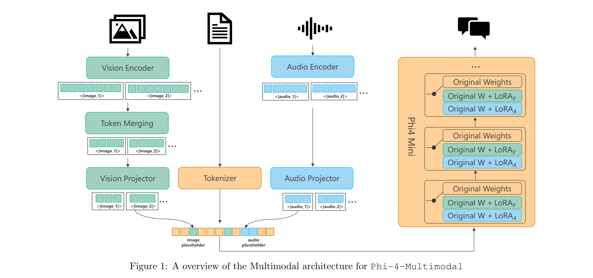

# Phi-4-Mini Technical Report: Compact yet Powerful Multimodal Language Models via Mixture-of-LoRAs

[Official source](https://arxiv.org/abs/2503.01743)

## Abstract

We introduce Phi-4-Mini and Phi-4-Multimodal, compact yet highly capable language and multimodal models. Phi-4-Mini is a 3.8-billion-parameter language model trained on high-quality web and synthetic data, significantly outperforming recent open-source models of similar size and matching the performance of models twice its size on math and coding tasks requiring complex reasoning. This achievement is driven by a carefully curated synthetic data recipe emphasizing highquality math and coding datasets. Compared to its predecessor, Phi-3.5-Mini, Phi-4-Mini features an expanded vocabulary size of 200K tokens to better support multilingual applications, as well as group query attention for more efficient long-sequence generation. Phi-4-Multimodal is a multimodal model that integrates text, vision, and speech/audio input modalities into a single model. Its novel modality extension approach leverages LoRA adapters and modality-specific routers to allow multiple inference modes combining various modalities without interference. For example, it now ranks first in the OpenASR leaderboard to date, although the LoRA component of the speech/audio modality has just 460 million parameters. Phi-4-Multimodal supports scenarios involving (vision + language), (vision + speech), and (speech/audio) inputs, outperforming larger vision-language and speech-language models on a wide range of tasks. Additionally, we experiment to further train Phi-4-Mini to enhance its reasoning capabilities.1. Despite its compact 3.8-billion-parameter size, this experimental version achieves reasoning performance on par with or surpassing significantly larger models, including DeepSeek-R1-Distill-Qwen-7B and DeepSeek-R1-Distill-Llama-8B.

Figure 1: A overview of the Multimodal architecture for Phi-4-Multimodal

p. 4
