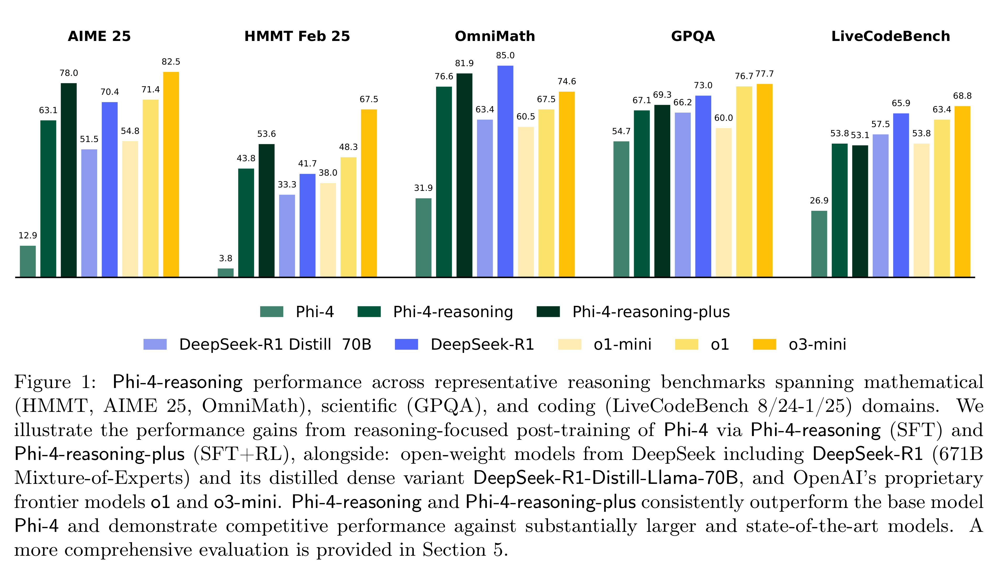

# Phi-4-reasoning Technical Report

[Official source](https://arxiv.org/abs/2504.21318)

## Abstract

We introduce Phi-4-reasoning, a 14-billion parameter reasoning model that achieves strong performance on complex reasoning tasks. Trained via supervised fine-tuning of Phi-4 on carefully curated set of “teachable” prompts–selected for the right level of complexity and diversity–and reasoning demonstrations generated using o3-mini, Phi-4-reasoning generates detailed reasoning chains that effectively leverage inference-time compute. We further develop Phi-4-reasoning-plus, a variant enhanced through a short phase of outcome-based reinforcement learning that offers higher performance by generating longer reasoning traces. Across a wide range of reasoning tasks, both models outperform significantly larger open-weight models such as DeepSeekR1-Distill-Llama-70B model and approach the performance levels of full DeepSeek-R1 model. Our comprehensive evaluations span benchmarks in math and scientific reasoning, coding, algorithmic problem solving, planning, and spatial understanding. Interestingly, we observe a non-trivial transfer of improvements to general-purpose benchmarks as well. In this report, we provide insights into our training data, our training methodologies, and our evaluations. We show that the benefit of careful data curation for supervised fine-tuning (SFT) extends to reasoning language models, and can be further amplified by reinforcement learning (RL). Finally, our evaluation points to opportunities for improving how we assess the performance and robustness of reasoning models.

Figure 1: Phi-4-reasoning performance across representative reasoning benchmarks spanning mathematical (HMMT, AIME 25, OmniMath), scientific (GPQA), and coding (LiveCodeBench 8/24-1/25) domains. We illustrate the performance gains from reasoning-focused post-training of Phi-4 via Phi-4-reasoning (SFT) and Phi-4-reasoning-plus (SFT+RL), alongside: open-weight models from DeepSeek including DeepSeek-R1 (671B Mixture-of-Experts) and its distilled dense variant DeepSeek-R1-Distill-Llama-70B, and OpenAI’s proprietary frontier models o1 and o3-mini. Phi-4-reasoning and Phi-4-reasoning-plus consistently outperform the base model Phi-4 and demonstrate competitive performance against substantially larger and state-of-the-art models. A more comprehensive evaluation is provided in Section 5.

p. 1
