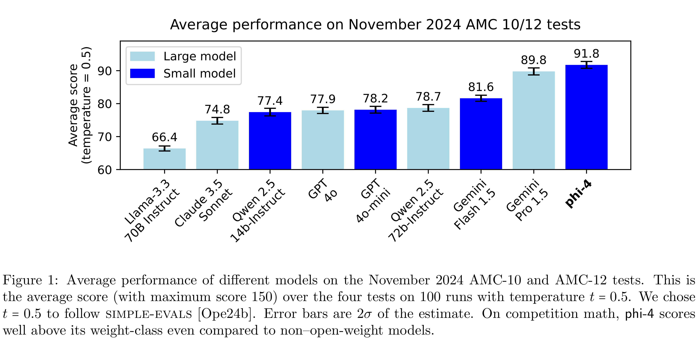

# Phi-4 Technical Report

[Official source](https://www.microsoft.com/en-us/research/publication/phi-4-technical-report/)

## Abstract

We present phi-4, a 14-billion parameter language model developed with a training recipe that is centrally focused on data quality. Unlike most language models, where pre-training is based primarily on organic data sources such as web content or code, phi-4 strategically incorporates synthetic data throughout the training process. While previous models in the Phi family largely distill the capabilities of a teacher model (specifically GPT-4), phi-4 substantially surpasses its teacher model on STEM-focused QA capabilities, giving evidence that our data-generation and post-training techniques go beyond distillation. Despite minimal changes to the phi-3 architecture, phi-4 achieves strong performance relative to its size – especially on reasoning-focused benchmarks – due to improved data, training curriculum, and innovations in the post-training scheme.

Figure 1: Average performance of different models on the November 2024 AMC-10 and AMC-12 tests. This is the average score (with maximum score 150) over the four tests on 100 runs with temperature t = 0.5. We chose t = 0.5 to follow simple-evals [Ope24b]. Error bars are 2σ of the estimate. On competition math, phi-4 scores well above its weight-class even compared to non–open-weight models.

p. 3
