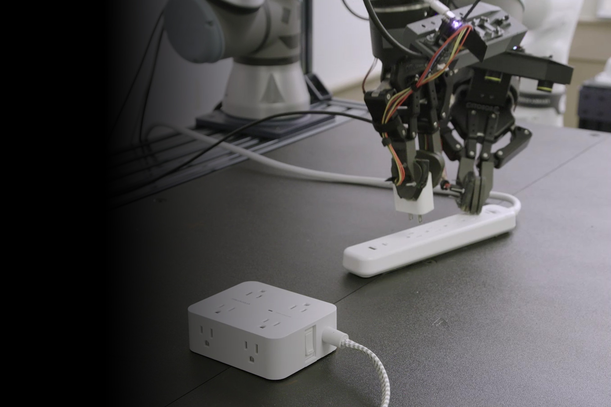

# Rho-alpha

[Official source](https://www.microsoft.com/en-us/research/story/advancing-ai-for-the-physical-world/)

Today, we are announcing Rho-alpha (ρα), our first robotics model derived from Microsoft’s Phi series of vision-language models.

We invite organizations interested in evaluating Rho-alpha for their robots and use cases to express interest in the Rho-alpha Research Early Access Program. Rho-alpha will also be made available via Microsoft Foundry at a later date.

Rho-alpha translates natural language commands into control signals for robotic systems performing bimanual manipulation tasks. It can be described as a VLA+ model in that it expands the set of perceptual and learning modalities beyond those typically used by VLAs. For perception, Rho-alpha adds tactile sensing, with efforts underway to accommodate modalities such as force. For learning, we are working toward enabling Rho-alpha to continually improve during deployment by learning from feedback provided by people.

