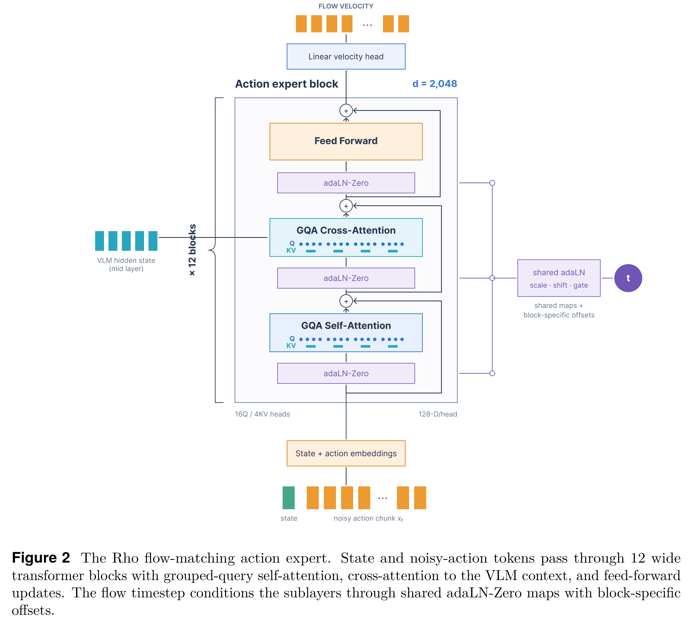
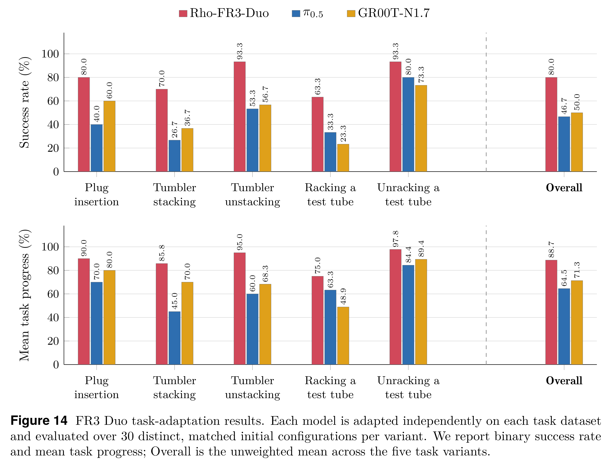

# Rho: A Foundation for Efficiently Adaptable VLA Models

[Official source](https://arxiv.org/abs/2609.38164)

## 1 Introduction

Physical AI implemented as vision-language-action (VLAs) and world-action models (WAMs) offers a path toward general-purpose robot manipulation by combining the semantic and perceptual capabilities of pretrained vision-language backbones (VLMs) with action generation [4, 14, 20, 21, 23, 44, 74]. Recent models of this type have been exposed to increasingly broad task coverage and expressive continuous control during training. However, zero-shot success rates of existing VLA and WAMs on unseen manipulation tasks and in new environments remain low. Adaptation is a crucial and complex step between a pretrained robot foundation model and a version of it that works in practice.

This report introduces Rho, an open-weights family of 5B-parameter physical AI models for bimanual robotic manipulation explicitly designed for data-efficient adaptation to new environments and tasks. Rho’s central premise is that, in order to quickly learn a new task, a physical AI model needs to master vision, language, and control of the specific robot that is expected to perform this task before task adaptation begins. Pretraining is insufficient for this: it typically exposes the model to a broad but superficial mixture of tasks, environments, and embodiments, without focusing on sensing, kinematics, action space, and data conventions of any robot in particular. Directly teaching a pretrained model to complete an unseen task, then, involves familiarizing it with the control of the target robot platform, which makes the adaptation process data-intensive. Rho’s training recipe separates adaptation to a robot embodiment from adaptation to a task, absorbing a large part of the task adaptation burden into the Rho models we present. The Rho family derives from a single foundation, Rho-base, and consists of several VLAs that can serve as reusable starting points for adapting to many downstream tasks much more data-efficiently than a pretrained-only model would, as our empirical evaluation demonstrates. We also show that after offline task specialization, these VLAs can continue improving from interaction through an internal latent policy, covering blind spots left by typically small finetuning datasets.

We release the Rho foundation Rho-base along with its variants for 3 representative robot platforms for bimanual manipulation – I2RT YAM Box, Universal Robots AI Trainer, and Franka FR3 Duo (Figure 1). Each of these Rho variants is built via a recipe we call regularized progressive adaptation, whose steps expose the model to various forms of robotic manipulation training while taking care to preserve useful visual, linguistic, and control capabilities gained in the previous training stages. As a starting point, Rho uses a backbone distilled from Microsoft’s Phi-family VLM [3]. Rho’s training recipe adapts this backbone for physical-world comprehension, couples it to a flow-matching action expert that generates continuous action chunks, and pretrains it in the end-effector-pose action space on a multi-task multi-embodiment data mixture that is dominated by demonstrations from dual-arm robot platforms but also includes robotics-relevant Web VQA data. This produces the foundation Rho-base and is followed by Rho-base’s multi-task single-embodiment midtraining. The embodiment-midtraining stage is key: during it, Rho-base focuses on learning to control a target robot across a broad distribution of tasks, motions, and environments, giving rise to Rho family’s embodiment-specific VLAs Rho-YAM-Box, Rho-UR- AI-Trainer, and Rho-FR3-Duo. Offline task adaptation comes after horizontal midtraining and finetunes these VLAs to a target task. For continued adaptation after deployment, each of Rho-family VLA’s flow module includes an optional internal latent policy that maps the current observation to the flow’s initial condition, replacing random sampling while leaving the action generator fixed. In our online experiments, only this lightweight internal module learns from corrective interaction, preserving the broader capabilities acquired earlier and serving as a form of regularization.

Our experiments assess whether this combination of reusable embodiment checkpoints and offline as well as online adaptation provides a practical route from a generalist VLA to reliable task execution, both in simulation and on physical robots. We systematically study the architecture of Rho’s action expert, the composition and scheduling of its pretraining mixture, and the effect of its embodiment midtraining on its downstream task adaptation. Across the settings and open-weights baselines evaluated in this report, Rho achieves the strongest overall performance.

Thus, the main contributions of our work are:

• We release the Rho model family consisting of the Rho-base foundation checkpoint and its 3 embodiment-midtrained VLA variants Rho-YAM-Box, Rho-UR-AI-Trainer, and Rho- FR3-Duo, for researchers and practitioners to adapt to their own robotic manipulation scenarios.

• We systematically evaluate Rho’s architectural and multi-stage training recipe that com- bines physical grounding with heterogeneous, multi-embodiment multi-task robot data, horizontal embodiment midtraining, and vertical task adaptation. Our studies, performed in RoboTwin [8], LIBERO [34], and RoboEval [59] simulation environment, and on common dual-arm robot setups YAM Box, UR AI Trainer, and FR3 Duo demonstrate this recipe’s broad positive effects.

• We empirically analyze the influence of midtraining on downstream adaptation and show that it halves the amount of task finetuning data needed to achieve a given success rate threshold, compared to finetuning pretrained Rho without midtraining. We also demonstrate that Rho can continue improving after offline task specialization by adapting its internal latent policy from corrective interaction.

Together, these results establish Rho as a strong open-weights VLA and, more broadly, examine how architecture, pretraining, embodiment midtraining, and task adaptation interact in a practical robot-learning pipeline.

Figure 2 The Rho flow-matching action expert. State and noisy-action tokens pass through 12 wide transformer blocks with grouped-query self-attention, cross-attention to the VLM context, and feed-forward updates. The flow timestep conditions the sublayers through shared adaLN-Zero maps with block-specific offsets.

p. 6

Figure 14 FR3 Duo task-adaptation results. Each model is adapted independently on each task dataset and evaluated over 30 distinct, matched initial configurations per variant. We report binary success rate and mean task progress; Overall is the unweighted mean across the five task variants.

p. 25
