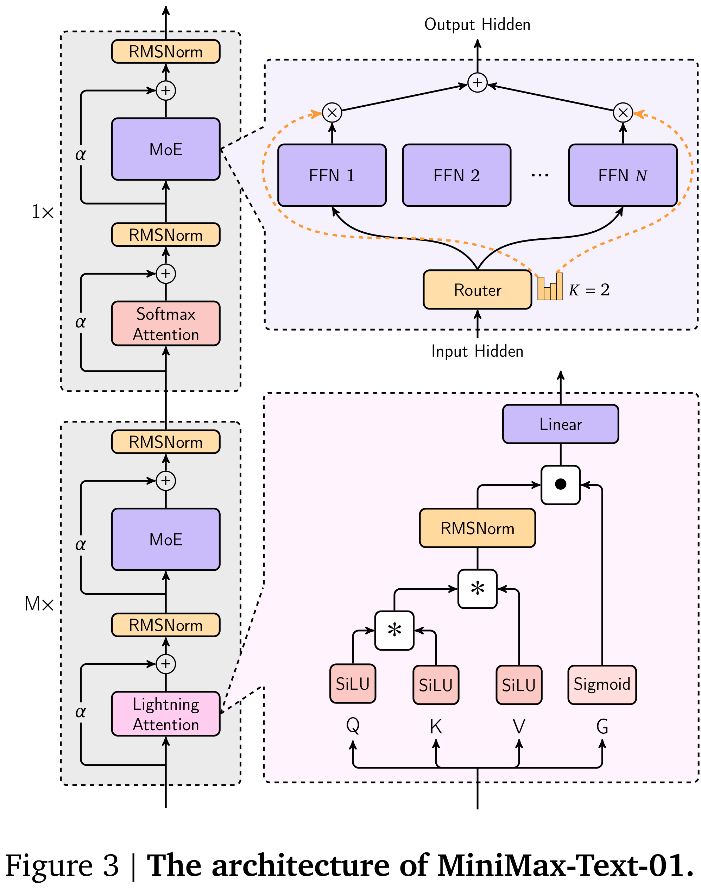

# MiniMax-01: Scaling Foundation Models with Lightning Attention

[Official source](https://github.com/MiniMax-AI/MiniMax-01)

We introduce MiniMax-01 series, including MiniMax-Text-01 and MiniMax-VL-01, which are comparable to top-tier models while offering superior capabilities in processing longer contexts. The core lies in lightning attention and its efficient scaling. To maximize computational capacity, we integrate it with Mixture of Experts (MoE), creating a model with 32 experts and 456 billion total parameters, of which 45.9 billion are activated for each token. We develop an optimized parallel strategy and highly efficient computation-communication overlap techniques for MoE and lightning attention. This approach enables us to conduct efficient training and inference on models with hundreds of billions of parameters across contexts spanning millions of tokens. The context window of MiniMax-Text-01 can reach up to 1 million tokens during training and extrapolate to 4 million tokens during inference at an affordable cost. Our vision-language model, MiniMax-VL-01 is built through continued training with 512 billion vision-language tokens. Experiments on both standard and in-house benchmarks show that our models match the performance of state-of-the-art models like GPT-4o and Claude-3.5-Sonnet while offering a 20-32 times longer context window. We publicly release MiniMax-01 at https://github.com/MiniMax-AI.

Figure 3 | The architecture of MiniMax-Text-01.

p. 4
