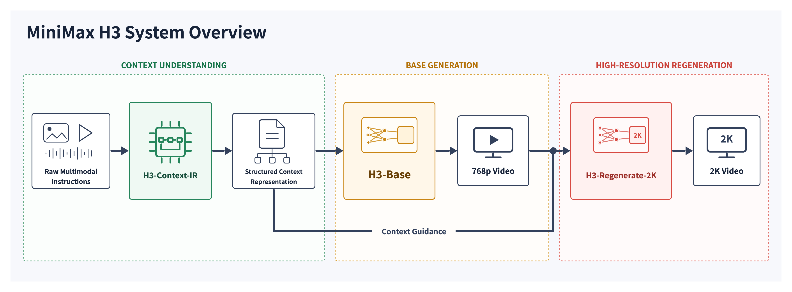
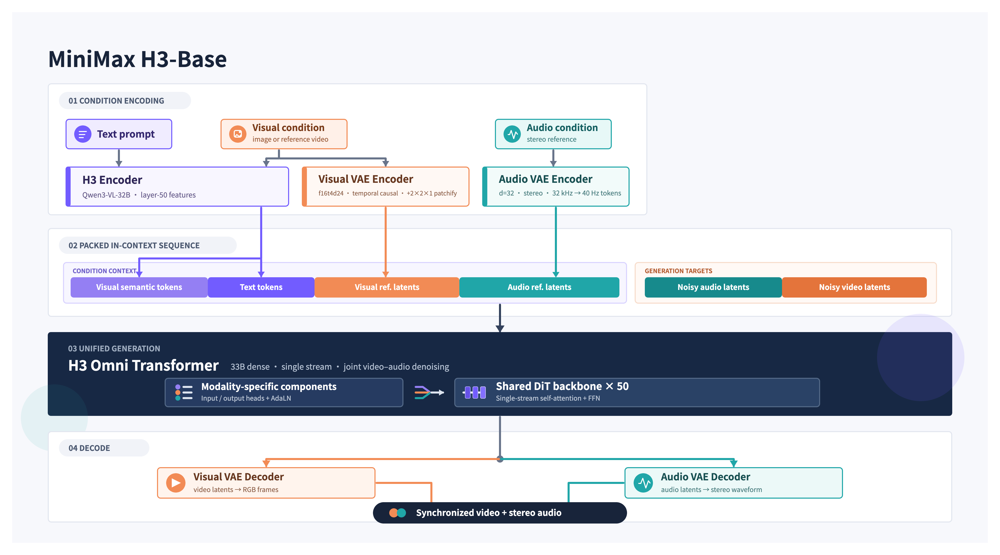

# MiniMax-H3

[Official source](https://huggingface.co/MiniMaxAI/MiniMax-H3)

## System Overview

MiniMax H3 is a general-purpose, omni-modal generative system. It supports unified understanding of multimodal contexts composed of text, images, video, and audio, and can generate video with native stereo audio at resolutions up to 2K and durations of up to 15 seconds. Thanks to its task-generalization-oriented system design, H3 already possesses broad multimodal context understanding and generation capabilities at the pre-training stage, enabling outstanding performance in following complex multimodal instructions.

