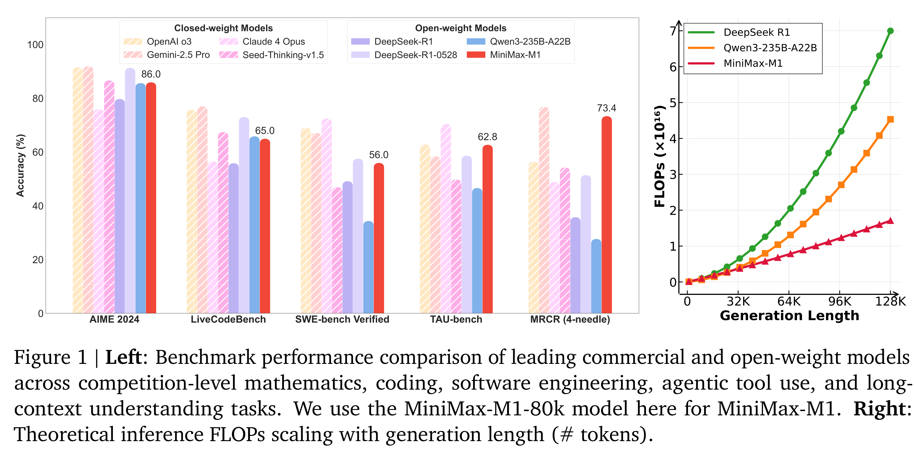

# MiniMax-M1: Scaling Test-Time Compute Efficiently with Lightning Attention

[Official source](https://github.com/MiniMax-AI/MiniMax-M1)

We introduce MiniMax-M1, the world’s first open-weight, large-scale hybrid-attention reasoning model. MiniMax-M1 is powered by a hybrid Mixture-of-Experts (MoE) architecture combined with a lightning attention mechanism. The model is developed based on our previous MiniMax-Text-01 model (MiniMax et al., 2025), which contains a total of 456 billion parameters with 45.9 billion parameters activated per token. The M1 model natively supports a context length of 1 million tokens, 8x the context size of DeepSeek R1. Furthermore, the lightning attention mechanism in MiniMax-M1 enables efficient scaling of test-time compute – For example, compared to DeepSeek R1, M1 consumes 25% of the FLOPs at a generation length of 100K tokens. These properties make M1 particularly suitable for complex tasks that require processing long inputs and thinking extensively. MiniMax-M1 is trained using large-scale reinforcement learning (RL) on diverse problems ranging from traditional mathematical reasoning to sandbox-based, real-world software engineering environments. In addition to the inherent efficiency advantage of lightning attention for RL training, we propose CISPO, a novel RL algorithm to further enhance RL efficiency. CISPO clips importance sampling weights rather than token updates, outperforming other competitive RL variants. Combining hybrid-attention and CISPO enables MiniMax-M1’s full RL training on 512 H800 GPUs to complete in only three weeks, with a rental cost of just $534,700. We release two versions of MiniMax-M1 models with 40K and 80K thinking budgets respectively, where the 40K model represents an intermediate phase of the 80K training. Experiments on standard benchmarks show that our models are comparable or superior to strong open-weight models such as the original DeepSeek-R1 and Qwen3-235B, with particular strengths in complex software engineering, tool utilization, and long-context tasks. Through efficient scaling of test-time compute, MiniMax-M1 serves as a strong foundation for next-generation language model agents to reason and tackle real-world challenges. We publicly release MiniMax-M1 at https://github.com/MiniMax-AI/MiniMax-M1.

Figure 1 | Left: Benchmark performance comparison of leading commercial and open-weight models across competition-level mathematics, coding, software engineering, agentic tool use, and long-context understanding tasks. We use the MiniMax-M1-80k model here for MiniMax-M1. Right: Theoretical inference FLOPs scaling with generation length (# tokens).

p. 1
