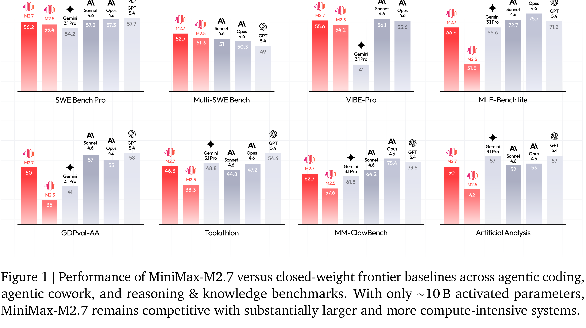

# The MiniMax-M2 Series: Mini Activations Unleashing Max Real-World Intelligence

[Official source](https://arxiv.org/abs/2605.26494)

We introduce the MiniMax-M2 series, a family of Mixture-of-Experts language models built around the principle that mini activations can unleash maximum real-world intelligence. The flagship M2 contains 229.9B total parameters with only 9.8B activated per token. Designed end-to-end for agentic deployment, the M2 series rests on three components: (i) agent-driven data pipelines producing large-scale, verifiable trajectories across agentic coding and agentic cowork, each grounded in an executable workspace and an artifact-aligned reward; (ii) Forge, a scalable agent-native RL system that adapts to long-horizon agent trajectories, paired with windowed-FIFO scheduling, prefix-tree merging, inference optimization, and a clean training–inference–agent decoupling that supports both white-box and black-box agents; (iii) the latest M2.7 checkpoint takes an early step toward self-evolution—autonomously debugging training runs and modifying its own scaffold. Across M2 through M2.7, this combination translates a mini-activation footprint into frontier-tier performance on agentic coding, deep search, office-task, and reasoning benchmarks.

Figure 1 | Performance of MiniMax-M2.7 versus closed-weight frontier baselines across agentic coding, agentic cowork, and reasoning & knowledge benchmarks. With only ∼10 B activated parameters, MiniMax-M2.7 remains competitive with substantially larger and more compute-intensive systems.

p. 1
