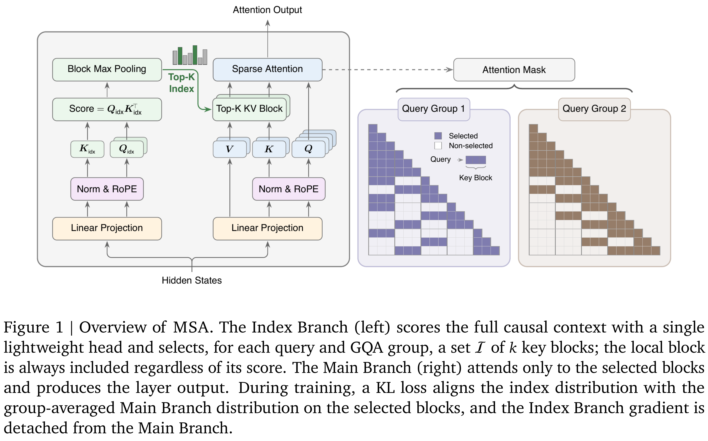

# MiniMax Sparse Attention

[Official source](https://github.com/MiniMax-AI/MiniMax-M3)

## 1. Introduction

Large language models (LLMs) are rapidly shifting from short, single-turn interactions to long-horizon agentic workflows that span hundreds of interleaved reasoning and action steps—writing and deploying production code, navigating the open web, orchestrating diverse tools, and producing structured documents (Anthropic, 2025; DeepSeek-AI, 2026; Google DeepMind, 2025; Moonshot AI, 2026; OpenAI, 2025; Zhipu AI, 2026). However, the ultra-long contexts these tasks demand impose severe compute and memory bottlenecks on both training and inference, with quadratic-cost softmax attention being the primary culprit, further amplified by the latency and throughput constraints of production-scale deployment.

Context length is a critical scaling dimension for LLMs, where trading off model quality against efficiency remains a formidable challenge. The community is actively pushing the Pareto frontier on this front. Hybrid architectures (MiniMax, 2025b; Qwen, 2026) replace a subset of softmax attention layers with efficient alternatives such as linear attention (Gu and Dao, 2023; Team et al., 2025a; Yang et al., 2025) or sliding window attention (MiMo et al., 2026; OpenAI et al., 2025). Alternatively, another line of work attempts to sparsify softmax attention (DeepSeek-AI, 2026; DeepSeek-AI et al., 2025; Lu et al., 2025; Team et al., 2025b) itself to break the computational bottleneck.

We introduce MiniMax Sparse Attention (MSA), designed following Occam’s razor: after extensive ablation, we retain only the essential components. MSA follows the sparse softmax attention paradigm to maximally reuse existing software and hardware infrastructure. We adopt blockwise token selection with a smaller top-𝑘, enabling efficient execution across a wider range of GPU architectures while relaxing the head-dimension constraints imposed by prior designs. Concretely, an ultra-lightweight Index Branch selects, for each attention group, the top-𝑘 blocks via max-pooling scoring, while always retaining the most recent block to ensure training stability.

Turning MSA’s theoretical sparsity into practical end-to-end speedups requires co-designing the algorithm with its GPU execution path. To this end, we design an exp-free TopK kernel specialized for the small-k regime, leveraging the blockwise indexer to bypass unnecessary softmax computation before selection. For the main attention branch, we organize sparse attention in a KV-outer order: selected KV blocks gather their associated queries and concatenate them to fill tensor-core MMAs, using pre-scheduled chunking with a two-phase combine to handle highly skewed block popularity without atomic updates. For training, we further fuse the auxiliary LSE computation required by the sparse KL loss into the forward pass and employ persistent load balancing in the backward pass.

To validate that MSA preserves both textual and multimodal capabilities, we compare it against Grouped Query Attention on a 109B-parameter Mixture of Experts (MoE) model trained from scratch with a 3T-token budget. MSA matches GQA on downstream benchmarks while delivering 14.2× prefill and 7.6× decoding speedups at 1M context length.

Main contributions.

• We propose MSA, a minimal, scalable, and accelerated blockwise sparse attention mechanism that supports both training from scratch and near-lossless conversion from pretrained GQA checkpoints.

• We co-design efficient training and inference kernels that turn MSA’s theoretical compute savings

into real wall-clock speedups at scale.

• We perform extensive ablations scaling up to a 109B-parameter MoE model with native multimodal training, dissecting MSA’s behavior across scales and modalities.

Figure 1 | Overview of MSA. The Index Branch (left) scores the full causal context with a single lightweight head and selects, for each query and GQA group, a set I of 𝑘key blocks; the local block is always included regardless of its score. The Main Branch (right) attends only to the selected blocks and produces the layer output. During training, a KL loss aligns the index distribution with the group-averaged Main Branch distribution on the selected blocks, and the Index Branch gradient is detached from the Main Branch.

p. 1
