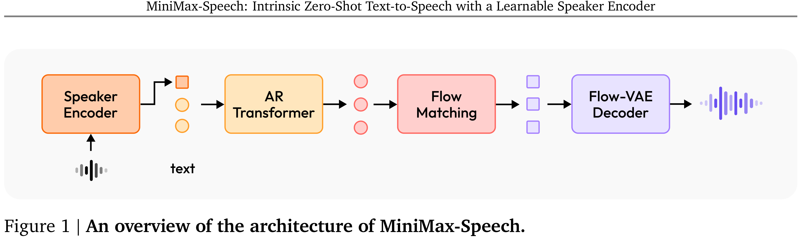

# MiniMax-Speech: Intrinsic Zero-Shot Text-to-Speech with a Learnable Speaker Encoder

[Official source](https://arxiv.org/abs/2505.07916)

We introduce MiniMax-Speech, an autoregressive Transformer-based Text-to-Speech (TTS) model that generates high-quality speech. A key innovation is our learnable speaker encoder, which extracts timbre features from a reference audio without requiring its transcription. This enables MiniMax-Speech to produce highly expressive speech with timbre consistent with the reference in a zero-shot manner, while also supporting one-shot voice cloning with exceptionally high similarity to the reference voice. In addition, the overall quality of the synthesized audio is enhanced through the proposed Flow-VAE. Our model supports 32 languages and demonstrates excellent performance across multiple objective and subjective evaluations metrics. Notably, it achieves state-of-the-art (SOTA) results on objective voice cloning metrics (Word Error Rate and Speaker Similarity) and has secured the top position on the public TTS Arena leaderboard. Another key strength of MiniMax-Speech, granted by the robust and disentangled representations from the speaker encoder, is its extensibility without modifying the base model, enabling various applications such as: arbitrary voice emotion control via LoRA; text to voice (T2V) by synthesizing timbre features directly from text description; and professional voice cloning (PVC) by fine-tuning timbre features with additional data. We encourage readers to visit https://minimax-ai.github.io/tts_tech_report for more examples.

Figure 1 | An overview of the architecture of MiniMax-Speech.

p. 3
