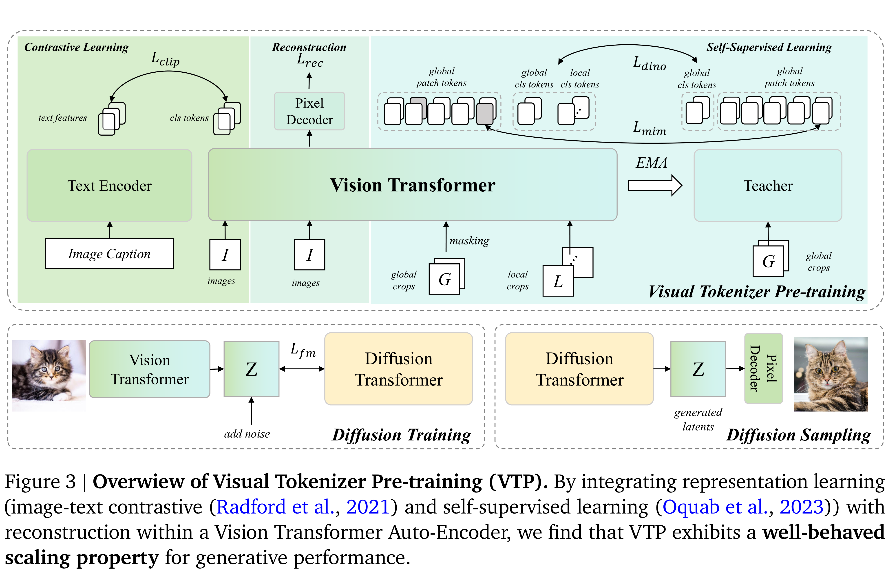

# Towards Scalable Pre-training of Visual Tokenizers for Generation

[Official source](https://arxiv.org/abs/2512.13687)

## 1. Introduction

Latent Diffusion Models (LDMs) (Rombach et al., 2022) employ a visual tokenizer, such as a VAE (Kingma and Welling, 2013), to compress visual signals into a latent space. Typically, visual tokenizers are pre-trained in a separate stage using a reconstruction objective.

However, a clear paradox has emerged: better reconstruction does not guarantee better generation. Instead, a noticeable trade-off between the two objectives is widely observed (Esser et al., 2024; Xie et al., 2024; Yao et al., 2025). It implies that scaling the computational investment in pre-training, while potentially further improving reconstruction performance, carries the risk of compromising generation performance (see fig. 1 (c)), which is consistent with prior work (Hansen-Estruch et al., 2025). We note that this limitation of reconstruction-only training may arise because the objective biases the latent space toward low-level information and, as training scales up, increasingly drives it away from the structured latent space we ultimately desire, thereby motivating the search for tokenizer pre-training schemes that genuinely scale—a challenge we term the “pre-training scaling problem”.

Unlike conventional approaches that emphasize low-level information, we propose that an effective latent space for generation should efficiently encode the core visual semantics. Early explorations have already demonstrated the value of this principle through two primary pathways. Some works explicitly

enrich the latent space with specific semantic objectives—for instance, by concatenating optical flow for motion or leveraging powerful pre-trained features to the latent space, like VideoJAM (Chefer et al.) and ReDi (Kouzelis et al., 2025). Others implicitly structure the space using semantic constraints, an approach seen in methods like VA-VAE (Yao et al., 2025) and REPA-E (Leng et al., 2025), which regularize the VAE’s feature space with representational priors. While promising, these efforts remain preliminary and do not explore broader scaling properties.

To address this challenge, we present VTP, a novel pre-training framework for visual tokenizers. The core contribution of our work is a redesigned, scalable paradigm for visual tokenizer pre-training that benefits generation. This is achieved by jointly optimizing the model across a spectrum of visual representation tasks, including cross-modal alignment, global semantic understanding, local spatial perception, and low-level pixel reconstruction. Technically, our framework is built upon a vision transformer (ViT) (Dosovitskiy, 2020) based Auto-Encoder. Building on the flexibility of the ViT architecture for representation learning, we integrate a suite of diverse learning objectives. First, cross-modal image-text contrastive learning is employed to instill a global semantic understanding (Ilharco et al., 2021; Radford et al., 2021). This is complemented by integrating established self-supervised learning techniques, notably self-distillation and mask image modeling (Caron et al., 2021; He et al., 2022; Oquab et al., 2023; Zhou et al., 2021), to enhance the model’s spatial-semantic perception. Throughout this multi-task learning process, the pixel-level reconstruction objective is consistently applied to preserve fine-grained visual details for generation. We posit that this holistic training paradigm encourages the latent space to form a unified and rich representation of visual information, which is instrumental in boosting the fidelity and semantic coherence of the generated outputs. (section 3)

Through extensive experiments, we reveal that perception-oriented tokenizer pre-training unlocks a new scaling frontier for generation: (1) Understanding is a key driver of generation: The introduction of semantic understanding and perception tasks enhances the generative capability of models initially

pre-trained solely on reconstruction. We observe a strong positive correlation between the semantic quality of the latent space and its generative performance. While these tasks differ in paradigm, they consistently inject more meaningful representations, leading to significant gains in downstream generation. (see fig. 2) (2) Superior Scalability for Generation: VTP is the first visual tokenizer to demonstrate scaling properties. Its generative performance improves steadily as we scale up training compute (FLOPs), model parameters, and dataset size of the visual tokenizer. This stands in stark contrast to traditional tokenizers pre-trained only on reconstruction, whose performance rapidly saturates and shows negligible gains with increased scale.

We conduct extensive experiments on ImageNet (Deng et al., 2009) class-conditional generation and LAION (Schuhmann et al., 2021) text-to-image generation. (1) We demonstrate new scalability for visual tokenizer pre-training: increasing pre-training compute accelerates the convergence of downstream VTP-based diffusion models. Specifically, scaling compute by 10× yields a 65.8% FID improvement for DiT on ImageNet, overcoming the early saturation of conventional autoencoders. (2) A systematic analysis reveals that diverse perception losses consistently improve general generation quality (section 4), and (3) specific losses offer targeted benefits for downstream tasks; e.g., CLIP loss significantly enhances text-to-image generation (section 5). (4) Our final model gets a strong performance, achieving 0.36 rFID on ImageNet alongside 78.2% zero-shot and 85.7% linear probing accuracy, outperforming unified tokenizers like VILA-U (Wu et al., 2024) and UniTok (Ma et al., 2025). Coupled with a DiT (Peebles and Xie, 2023; Yao et al., 2025), it enables exceptionally fast convergence (2.03 FID in just 80 epochs, unguided), surpassing prior approaches such as VA-VAE (Yao et al., 2025) and RAE (Zheng et al., 2025), and ultimately reaches a remarkable 1.11 gFID on generation tasks.

To sum up, our contribution could be summarized as follows:

• We propose Visual Tokenizer Pre-training (VTP), a framework integrating contrastive, self-supervised, and reconstruction objectives to build a perception-oriented tokenizer pre-training for generative models.

• We demonstrate a new scaling property for visual tokenizers: overcoming the early saturation of reconstruction-only training, downstream generation quality consistently improves as VTP pre-training scales in compute, parameters, and data.

• VTP pushes the boundaries of unified understanding and generation of visual encoder, achieving an impressive 1.11 gFID on ImageNet generation alongside 0.36 rFID, 78.2% zero-shot, and 85.7% linear probing accuracy.

Figure 3 | Overwiew of Visual Tokenizer Pre-training (VTP). By integrating representation learning (image-text contrastive (Radford et al., 2021) and self-supervised learning (Oquab et al., 2023)) with reconstruction within a Vision Transformer Auto-Encoder, we find that VTP exhibits a well-behaved scaling property for generative performance.

p. 5
