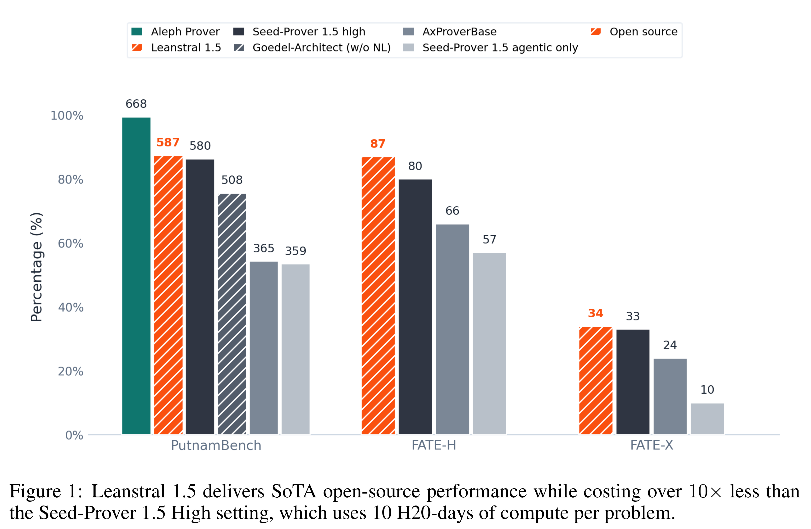

# Leanstral

[Official source](https://mistral.ai/news/leanstral-1-5/)

## Abstract

In this work, we present Leanstral, a series of generalist code-agent models for Lean 4 with 119B total and only 6B active parameters. Rather than a specialized prover scaffold, Leanstral operates directly within the open-sourced Mistral Vibe code-agent harness and uses no test-time-scaling method beyond context compaction, with performance scaling smoothly as the per-problem token budget grows. Despite its size, Leanstral delivers results that rival far larger and proprietary systems: it saturates miniF2F, solves 587/672 problems on PutnamBench, and reaches a new state-of-the-art 34% on FATE-X and 43.2% on FLTEval. Beyond competition mathematics, Leanstral resolves issues in real repositories spanning graduate-level mathematics, mathematical finance, and code verification. A fully automated pipeline built on Leanstral uncovered previously unknown bugs in open-source software. In this report, we detail our training recipe and how performance of Leanstral scales with test-time-compute. We open-source Leanstral 1.5 with an Apache-2.0 license.

Figure 1: Leanstral 1.5 delivers SoTA open-source performance while costing over 10× less than the Seed-Prover 1.5 High setting, which uses 10 H20-days of compute per problem.

p. 1
