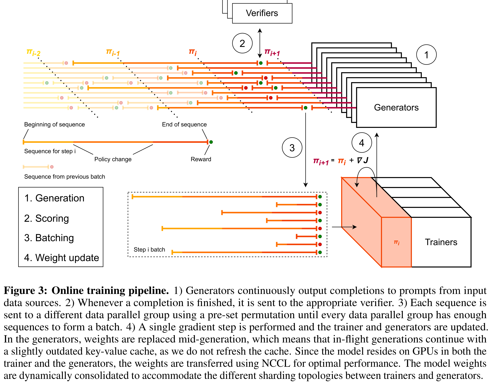

# Magistral

[Official source](https://arxiv.org/abs/2506.10910)

## Abstract

We introduce Magistral, Mistral’s first reasoning model and our own scalable reinforcement learning (RL) pipeline. Instead of relying on existing implementations and RL traces distilled from prior models, we follow a ground up approach, relying solely on our own models and infrastructure. Notably, we demonstrate a stack that enabled us to explore the limits of pure RL training of LLMs, present a simple method to force the reasoning language of the model, and show that RL on text data alone maintains most of the initial checkpoint’s capabilities. We find that RL on text maintains or improves multimodal understanding, instruction following and function calling. We present Magistral Medium, trained for reasoning on top of Mistral Medium 3 with RL alone, and we open-source Magistral Small (Apache 2.0) which further includes cold-start data from Magistral Medium.

Figure 3: Online training pipeline. 1) Generators continuously output completions to prompts from input data sources. 2) Whenever a completion is finished, it is sent to the appropriate verifier. 3) Each sequence is sent to a different data parallel group using a pre-set permutation until every data parallel group has enough sequences to form a batch. 4) A single gradient step is performed and the trainer and generators are updated. In the generators, weights are replaced mid-generation, which means that in-flight generations continue with a slightly outdated key-value cache, as we do not refresh the cache. Since the model resides on GPUs in both the trainer and the generators, the weights are transferred using NCCL for optimal performance. The model weights are dynamically consolidated to accommodate the different sharding topologies between trainers and generators.

p. 6
