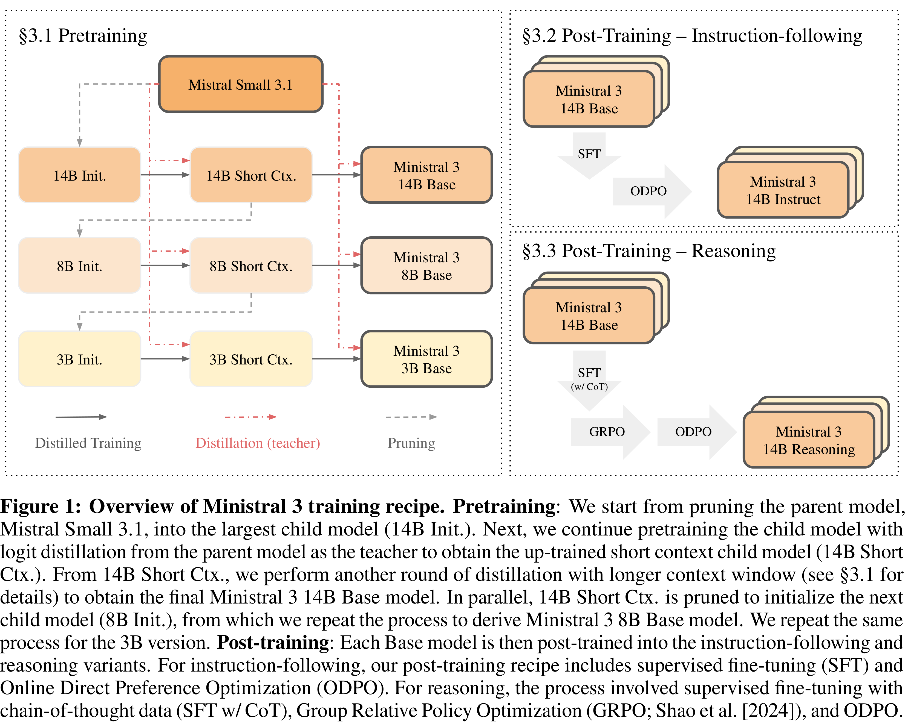

# Ministral 3

[Official source](https://mistral.ai/news/mistral-3/)

## Abstract

We introduce the Ministral 3 series, a family of parameter-efficient dense language models designed for compute and memory constrained applications, available in three model sizes: 3B, 8B, and 14B parameters. For each model size, we release three variants: a pretrained base model for general-purpose use, an instruction finetuned, and a reasoning model for complex problem-solving. In addition, we present our recipe to derive the Ministral 3 models through Cascade Distillation, an iterative pruning and continued training with distillation technique. Each model comes with image understanding capabilities, all under the Apache 2.0 license. Webpage: https://mistral.ai/news/mistral-3 Models: https://huggingface.co/collections/mistralai/ministral-3

Figure 1: Overview of Ministral 3 training recipe. Pretraining: We start from pruning the parent model, Mistral Small 3.1, into the largest child model (14B Init.). Next, we continue pretraining the child model with logit distillation from the parent model as the teacher to obtain the up-trained short context child model (14B Short Ctx.). From 14B Short Ctx., we perform another round of distillation with longer context window (see §3.1 for details) to obtain the final Ministral 3 14B Base model. In parallel, 14B Short Ctx. is pruned to initialize the next child model (8B Init.), from which we repeat the process to derive Ministral 3 8B Base model. We repeat the same process for the 3B version. Post-training: Each Base model is then post-trained into the instruction-following and reasoning variants. For instruction-following, our post-training recipe includes supervised fine-tuning (SFT) and Online Direct Preference Optimization (ODPO). For reasoning, the process involved supervised fine-tuning with chain-of-thought data (SFT w/ CoT), Group Relative Policy Optimization (GRPO; Shao et al. [2024]), and ODPO.

p. 2
