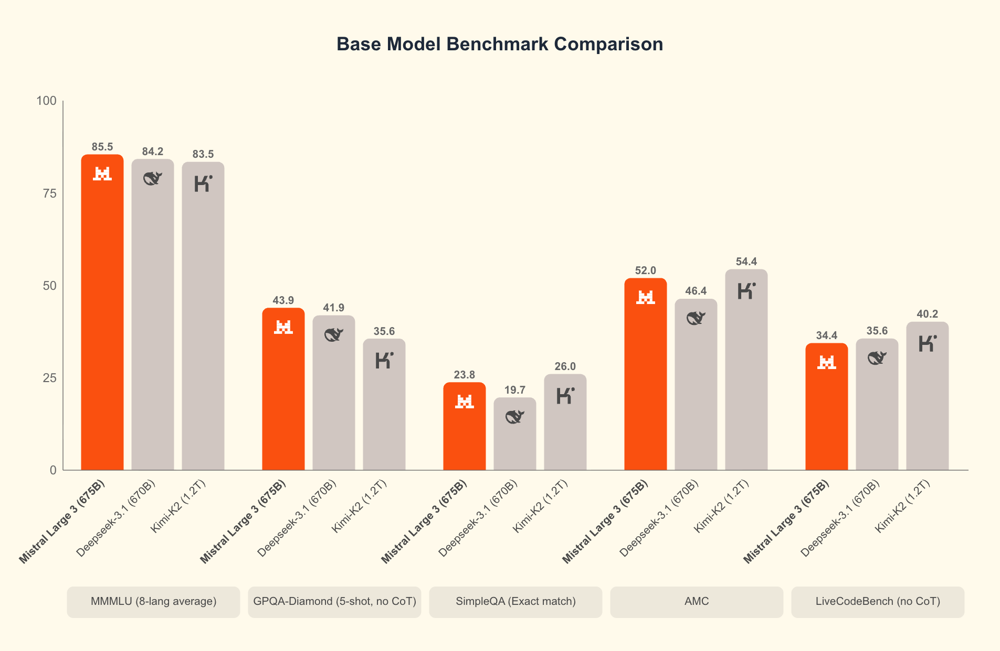
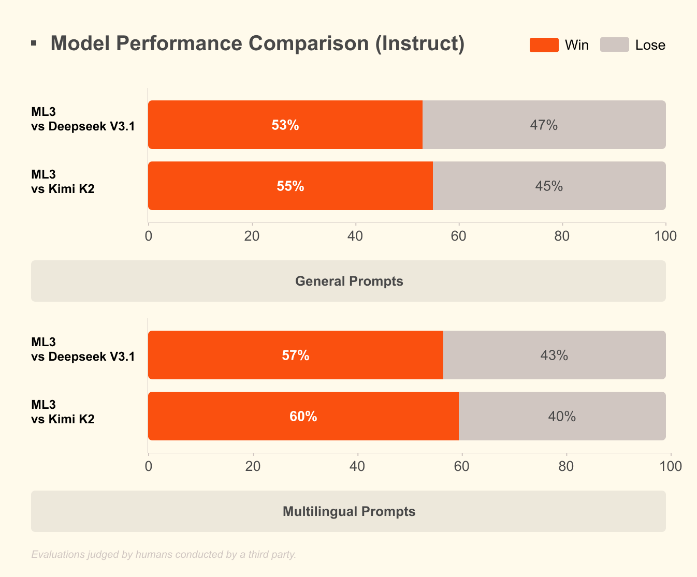
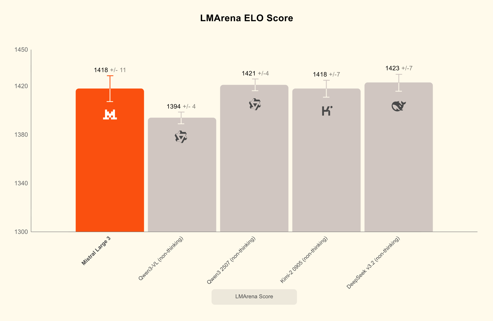

# Mistral Large 3

[Official source](https://huggingface.co/mistralai/Mistral-Large-3-675B-Instruct-2512)

From our family of large models, Mistral Large 3 is a state-of-the-art general-purpose Multimodal granular Mixture-of-Experts model with 41B active parameters and 675B total parameters trained from the ground up with 3000 H200s.

This model is the instruct post-trained version in FP8, fine-tuned for instruction tasks, making it ideal for chat, agentic and instruction based use cases. Designed for reliability and long-context comprehension - It is engineered for production-grade assistants, retrieval-augmented systems, scientific workloads, and complex enterprise workflows.

