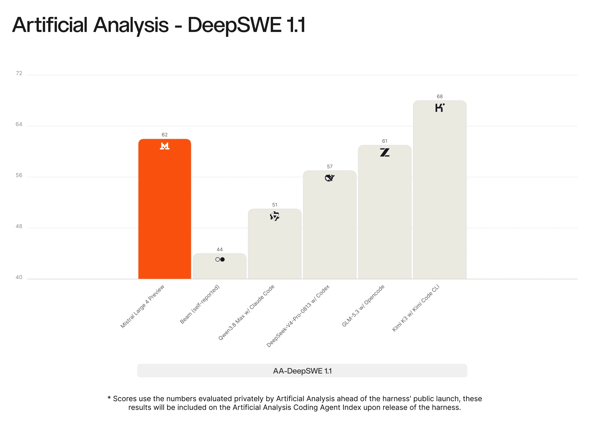
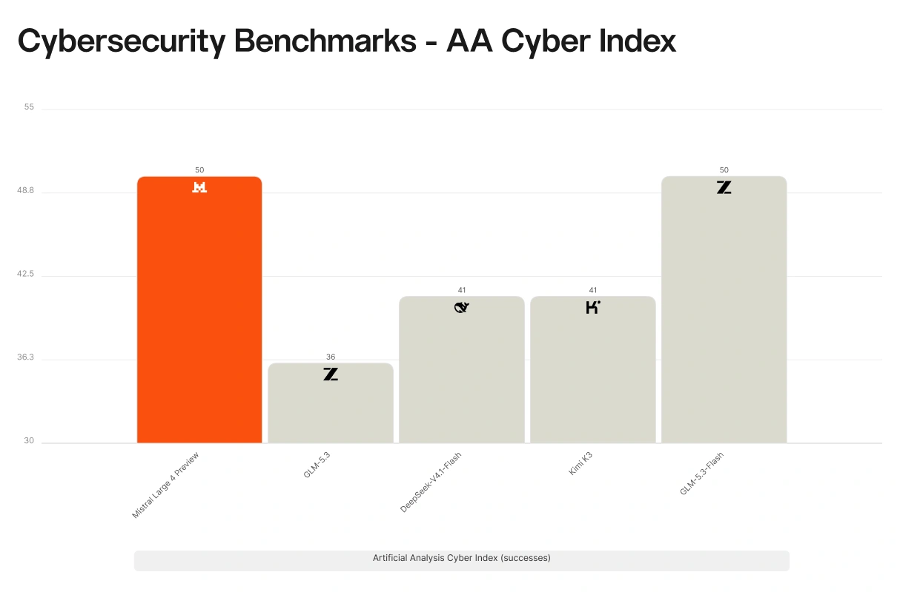
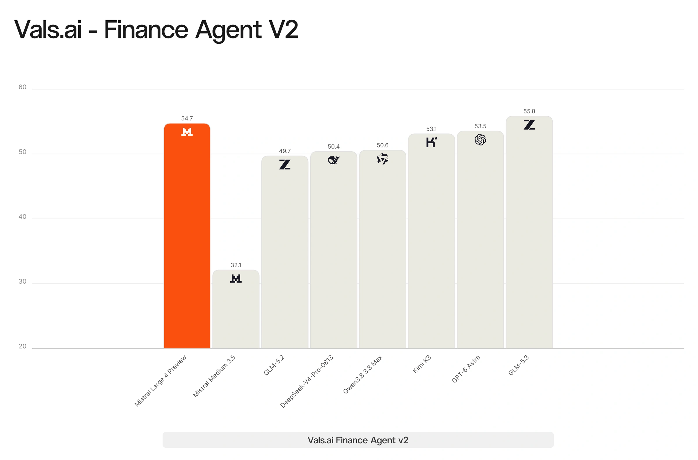

# Mistral Large 4 (Public Preview)

[Official source](https://mistral.ai/news/mistral-large-4/)

Today, we’re launching a public preview of Mistral Large 4. Unofficially ML4, very officially: le Chonk. ML4 pushes the frontier of open-weight performance. You can try the preview API today on Mistral Studio. Weights drop end of this month.

ML4 is a 1 trillion-parameter natively multimodal model with 52 billion active parameters. It is our largest and most capable model to date, and it continues to improve rapidly as we refine it.

The model demonstrates exceptional performance across coding, agentic workflows, and multimodal understanding. It already achieves performance competitive with the strongest open-source models globally, while significantly outperforming any open-weight model developed in the US or Europe. On critical enterprise workloads, including cybersecurity, finance and law, we find it to be state-of-the-art among open models. In some domains such as visual grounding, it goes further still, surpassing even frontier closed models.

We will release the weights by the end of the month. Until then, we are red-teaming the model in real-world settings with cybersecurity leaders, vetted partners, and state authorities, who will access the same model with reduced moderation and expanded cyber capabilities.

