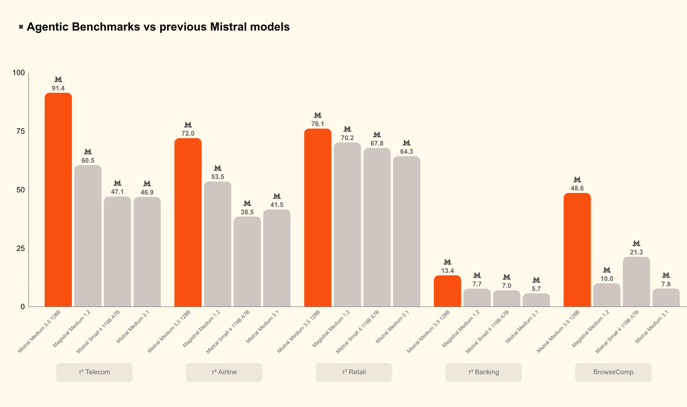
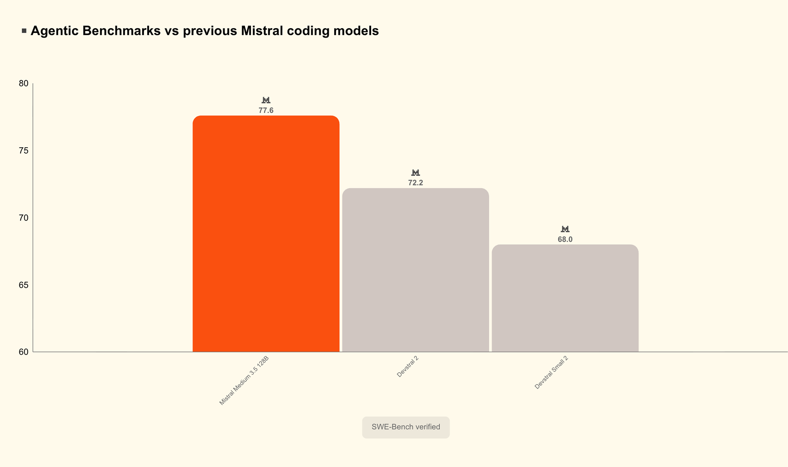
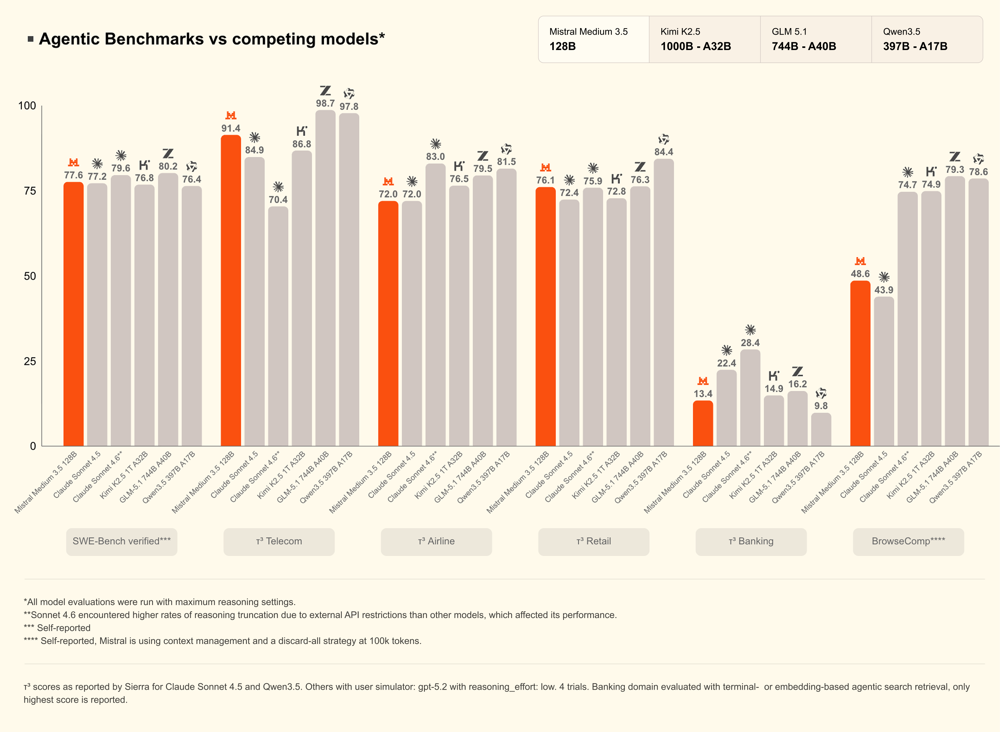
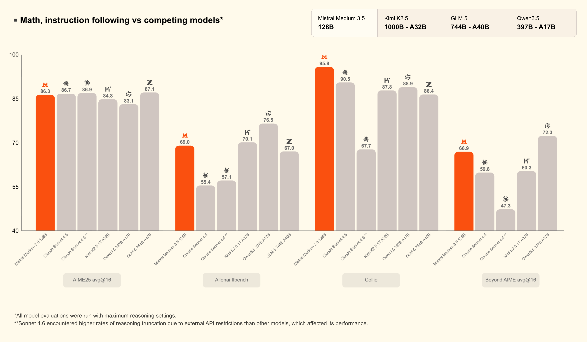

# Mistral Medium 3.5

[Official source](https://huggingface.co/mistralai/Mistral-Medium-3.5-128B)

Mistral Medium 3.5 is our first flagship merged model. It is a dense 128B model with a 256k context window, handling instruction-following, reasoning, and coding in a single set of weights. Mistral Medium 3.5 replaces its predecessor Mistral Medium 3.1 and Magistral in Le Chat. It also replaces Devstral 2 in our coding agent Vibe. Concretely, expect better performance for instruct, reasoning and coding tasks in a new unified model in comparison with our previous released models.

Reasoning effort is configurable per request, so the same model can answer a quick chat reply or work through a complex agentic run. We trained the vision encoder from scratch to handle variable image sizes and aspect ratios.

