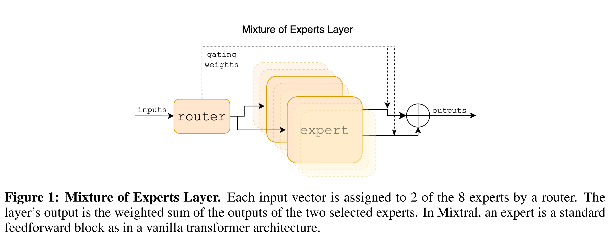

# Mixtral of Experts

[Official source](https://arxiv.org/abs/2401.04088)

## Abstract

We introduce Mixtral 8x7B, a Sparse Mixture of Experts (SMoE) language model. Mixtral has the same architecture as Mistral 7B, with the difference that each layer is composed of 8 feedforward blocks (i.e. experts). For every token, at each layer, a router network selects two experts to process the current state and combine their outputs. Even though each token only sees two experts, the selected experts can be different at each timestep. As a result, each token has access to 47B parameters, but only uses 13B active parameters during inference. Mixtral was trained with a context size of 32k tokens and it outperforms or matches Llama 2 70B and GPT-3.5 across all evaluated benchmarks. In particular, Mixtral vastly outperforms Llama 2 70B on mathematics, code generation, and multilingual benchmarks. We also provide a model fine-tuned to follow instructions, Mixtral 8x7B – Instruct, that surpasses GPT-3.5 Turbo, Claude-2.1, Gemini Pro, and Llama 2 70B – chat model on human benchmarks. Both the base and instruct models are released under the Apache 2.0 license.

Code: https://github.com/mistralai/mistral-src Webpage: https://mistral.ai/news/mixtral-of-experts/

Figure 1: Mixture of Experts Layer. Each input vector is assigned to 2 of the 8 experts by a router. The layer’s output is the weighted sum of the outputs of the two selected experts. In Mixtral, an expert is a standard feedforward block as in a vanilla transformer architecture.

p. 2
