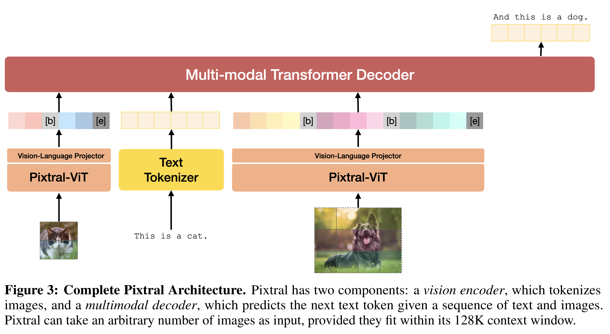

# Pixtral 12B

[Official source](https://arxiv.org/abs/2410.07073)

## Abstract

We introduce Pixtral 12B, a 12–billion-parameter multimodal language model. Pixtral 12B is trained to understand both natural images and documents, achieving leading performance on various multimodal benchmarks, surpassing a number of larger models. Unlike many open-source models, Pixtral is also a cutting-edge text model for its size, and does not compromise on natural language performance to excel in multimodal tasks. Pixtral uses a new vision encoder trained from scratch, which allows it to ingest images at their natural resolution and aspect ratio. This gives users flexibility on the number of tokens used to process an image. Pixtral is also able to process any number of images in its long context window of 128K tokens. Pixtral 12B substanially outperforms other open models of similar sizes (Llama-3.2 11B & Qwen-2-VL 7B). It also outperforms much larger open models like Llama-3.2 90B while being 7x smaller. We further contribute an open-source benchmark, MM-MT-Bench, for evaluating vision-language models in practical scenarios, and provide detailed analysis and code for standardized evaluation protocols for multimodal LLMs. Pixtral 12B is released under Apache 2.0 license.

Figure 3: Complete Pixtral Architecture. Pixtral has two components: a vision encoder, which tokenizes images, and a multimodal decoder, which predicts the next text token given a sequence of text and images. Pixtral can take an arbitrary number of images as input, provided they fit within its 128K context window.

p. 4
