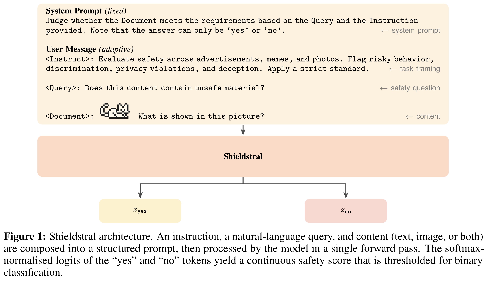
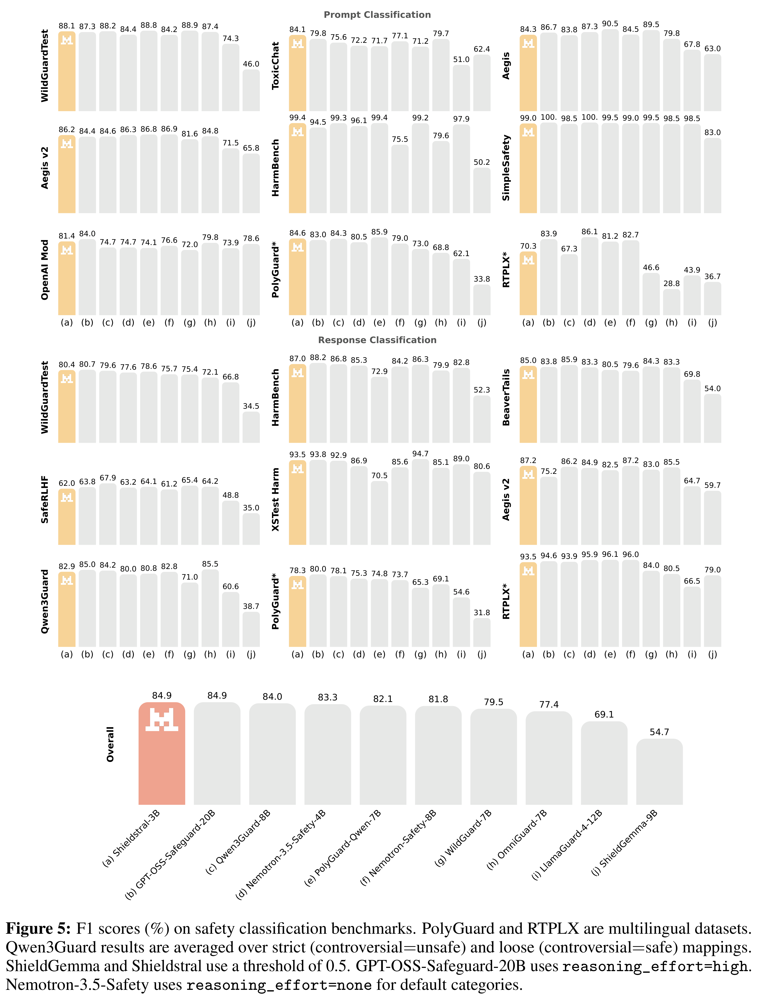

# Shieldstral

Models: Shieldstral

[Source summaries](../README.md) · [中文索引](../README_CN.md)

[Original PDF](../../pdfs/mistral/technical-reports/shieldstral--arxiv-v2.pdf#page=1) · [Official source](https://arxiv.org/abs/2607.25857)

PDF pages: 1 · Source text cross-checked with two extractors; not manually verified.

## Abstract

We introduce Shieldstral, a 3B-parameter policy-adaptive multimodal safety clas- sifier that matches or outperforms models nearly 7× its size on text safety bench- marks and sets a new state of the art on multimodal safety classification. Shieldstral formulates content moderation as a binary question-answering task. This simple formulation unifies diverse moderation tasks into a single yes/no problem, enabling heterogeneous safety datasets with divergent taxonomies to be consolidated under one training framework. We present the data construction recipe, covering curation and generation of approximately 54.1M samples and a fine-grained evaluation set to evaluate policy adaptability. Together, these enable a small adaptive model to match or outperform much larger models.

## Core figures

[All figures and original captions](../../figures/mistral/shieldstral/README.md) · [中文](../../figures/mistral/shieldstral/README_CN.md)

### Architecture · Figure 1

Source page: 2 · [Original graphics PDF](../../figures/mistral/shieldstral/figure-01.pdf) · [High-resolution PNG](../../figures/mistral/shieldstral/figure-01.png)

Figure 1: Shieldstral architecture. An instruction, a natural-language query, and content (text, image, or both)
are composed into a structured prompt, then processed by the model in a single forward pass. The softmax-
normalised logits of the “yes” and “no” tokens yield a continuous safety score that is thresholded for binary
classification.

### Safety Evaluation · Figure 5

Source page: 11 · [Original graphics PDF](../../figures/mistral/shieldstral/figure-02.pdf) · [High-resolution PNG](../../figures/mistral/shieldstral/figure-02.png)

Figure 5: F1 scores (%) on safety classification benchmarks. PolyGuard and RTPLX are multilingual datasets.
Qwen3Guard results are averaged over strict (controversial=unsafe) and loose (controversial=safe) mappings.
ShieldGemma and Shieldstral use a threshold of 0.5. GPT-OSS-Safeguard-20B uses reasoning_effort=high.
Nemotron-3.5-Safety uses reasoning_effort=none for default categories.
