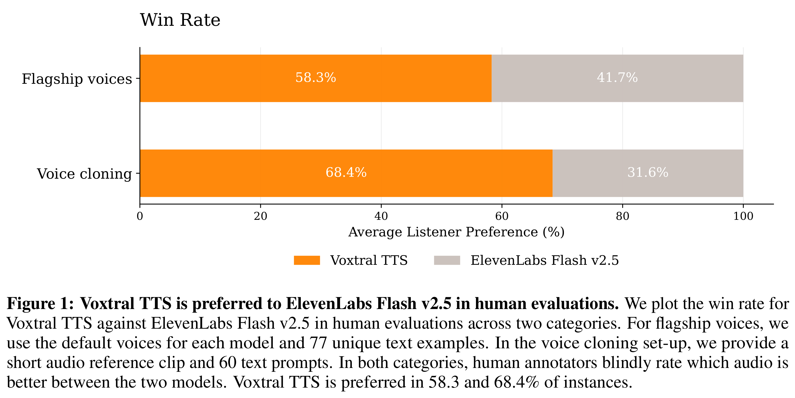
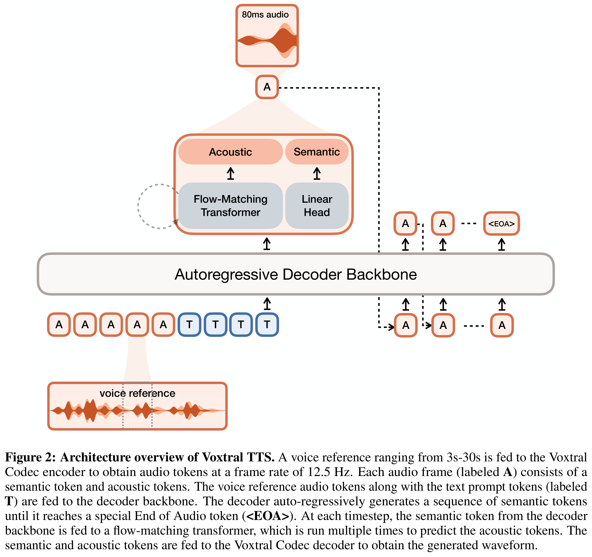

# Voxtral TTS

Models: Voxtral TTS

[Source summaries](../README.md) · [中文索引](../README_CN.md)

[Original PDF](../../pdfs/mistral/technical-reports/voxtral-tts--arxiv-v2.pdf#page=1) · [Official source](https://arxiv.org/abs/2603.25551)

PDF pages: 1 · Source text cross-checked with two extractors; not manually verified.

## Abstract

We introduce Voxtral TTS, an expressive multilingual text-to-speech model that generates natural speech from as little as 3 seconds of reference audio. Voxtral TTS adopts a hybrid architecture that combines auto-regressive generation of semantic speech tokens with flow-matching for acoustic tokens. These tokens are encoded and decoded with Voxtral Codec, a speech tokenizer trained from scratch with a hybrid VQ-FSQ quantization scheme. In human evaluations conducted by native speakers, Voxtral TTS is preferred for multilingual voice cloning due to its naturalness and expressivity, achieving a 68.4% win rate over ElevenLabs Flash v2.5. We release the model weights under a CC BY-NC license.

## Core figures

[All figures and original captions](../../figures/mistral/voxtral-tts/README.md) · [中文](../../figures/mistral/voxtral-tts/README_CN.md)

### Results · Figure 1

Source page: 1 · [Original graphics PDF](../../figures/mistral/voxtral-tts/figure-01.pdf) · [High-resolution PNG](../../figures/mistral/voxtral-tts/figure-01.png)

Figure 1: Voxtral TTS is preferred to ElevenLabs Flash v2.5 in human evaluations. We plot the win rate for
Voxtral TTS against ElevenLabs Flash v2.5 in human evaluations across two categories. For flagship voices, we
use the default voices for each model and 77 unique text examples. In the voice cloning set-up, we provide a
short audio reference clip and 60 text prompts. In both categories, human annotators blindly rate which audio is
better between the two models. Voxtral TTS is preferred in 58.3 and 68.4% of instances.

### Architecture · Figure 2

Source page: 3 · [Original graphics PDF](../../figures/mistral/voxtral-tts/figure-02.pdf) · [High-resolution PNG](../../figures/mistral/voxtral-tts/figure-02.png)

Figure 2: Architecture overview of Voxtral TTS. A voice reference ranging from 3s-30s is fed to the Voxtral
Codec encoder to obtain audio tokens at a frame rate of 12.5 Hz. Each audio frame (labeled A) consists of a
semantic token and acoustic tokens. The voice reference audio tokens along with the text prompt tokens (labeled
T) are fed to the decoder backbone. The decoder auto-regressively generates a sequence of semantic tokens
until it reaches a special End of Audio token (<EOA>). At each timestep, the semantic token from the decoder
backbone is fed to a flow-matching transformer, which is run multiple times to predict the acoustic tokens. The
semantic and acoustic tokens are fed to the Voxtral Codec decoder to obtain the generated waveform.
