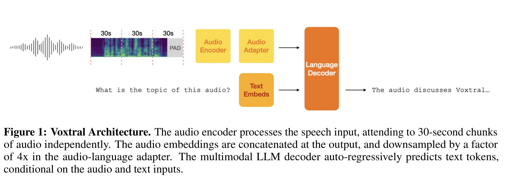

# Voxtral

[Official source](https://arxiv.org/abs/2507.13264)

## Abstract

We present Voxtral Mini and Voxtral Small, two multimodal audio chat models. Voxtral is trained to comprehend both spoken audio and text documents, achieving state-of-the-art performance across a diverse range of audio benchmarks, while preserving strong text capabilities. Voxtral Small outperforms a number of closed-source models, while being small enough to run locally. A 32K context window enables the model to handle audio files up to 40 minutes in duration and long multi-turn conversations. We also contribute three benchmarks for evaluating speech understanding models on knowledge and trivia. Both Voxtral models are released under Apache 2.0 license.

Figure 1: Voxtral Architecture. The audio encoder processes the speech input, attending to 30-second chunks of audio independently. The audio embeddings are concatenated at the output, and downsampled by a factor of 4x in the audio-language adapter. The multimodal LLM decoder auto-regressively predicts text tokens, conditional on the audio and text inputs.

p. 2
