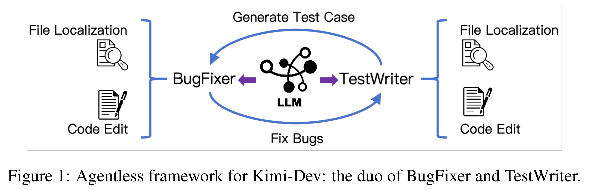

# Kimi-Dev: Agentless Training as Skill Prior for SWE-Agents

[Official source](https://github.com/MoonshotAI/Kimi-Dev)

## ABSTRACT

Large Language Models (LLMs) are increasingly applied to software engineering (SWE), with SWE-bench as a key benchmark. Solutions are split into SWE-Agent frameworks with multi-turn interactions and workflow-based Agentless methods with single-turn verifiable steps. We argue these paradigms are not mutually exclusive: reasoning-intensive Agentless training induces skill priors, including localization, code edit, and self-reflection that enable efficient and effective SWE-Agent adaptation. In this work, we first curate the Agentless training recipe and present Kimi-Dev, an open-source SWE LLM achieving 60.4% on SWE-bench Verified, the best among workflow approaches. With additional SFT adaptation on 5k publicly-available trajectories, Kimi-Dev powers SWE-Agents to 48.6% pass@1, on par with that of Claude 3.5 Sonnet (241022 version). These results show that structured skill priors from Agentless training can bridge workflow and agentic frameworks for transferable coding agents.

Figure 1: Agentless framework for Kimi-Dev: the duo of BugFixer and TestWriter.

p. 3
