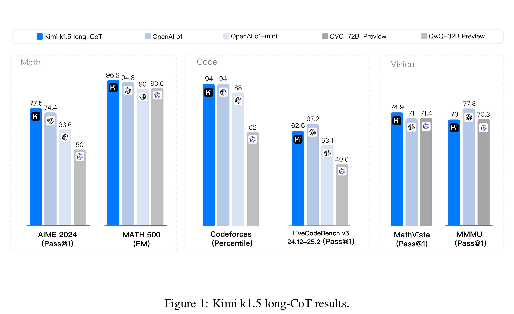

# Kimi k1.5: Scaling Reinforcement Learning with LLMs

[Official source](https://github.com/MoonshotAI/Kimi-k1.5)

## ABSTRACT

Language model pretraining with next token prediction has proved effective for scaling compute but is limited to the amount of available training data. Scaling reinforcement learning (RL) unlocks a new axis for the continued improvement of artificial intelligence, with the promise that large language models (LLMs) can scale their training data by learning to explore with rewards. However, prior published work has not produced competitive results. In light of this, we report on the training practice of Kimi k1.5, our latest multi-modal LLM trained with RL, including its RL training techniques, multi-modal data recipes, and infrastructure optimization. Long context scaling and improved policy optimization methods are key ingredients of our approach, which establishes a simplistic, effective RL framework without relying on more complex techniques such as Monte Carlo tree search, value functions, and process reward models. Notably, our system achieves state-of-the-art reasoning performance across multiple benchmarks and modalities—e.g., 77.5 on AIME, 96.2 on MATH 500, 94-th percentile on Codeforces, 74.9 on MathVista—matching OpenAI’s o1. Moreover, we present effective long2short methods that use long-CoT techniques to improve short-CoT models, yielding state-of-the-art short-CoT reasoning results—e.g., 60.8 on AIME, 94.6 on MATH500, 47.3 on LiveCodeBench—outperforming existing short-CoT models such as GPT-4o and Claude Sonnet 3.5 by a large margin (up to +550%).

Figure 1: Kimi k1.5 long-CoT results.

p. 1
